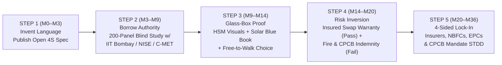
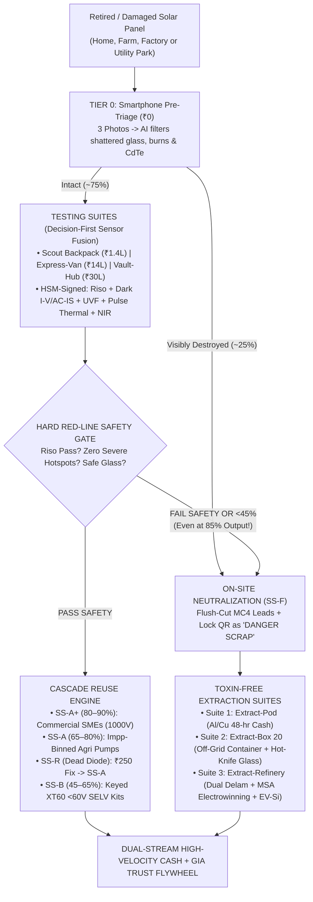
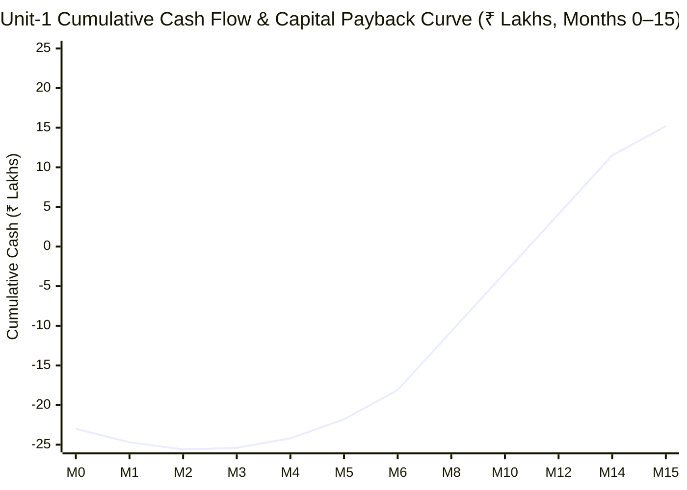
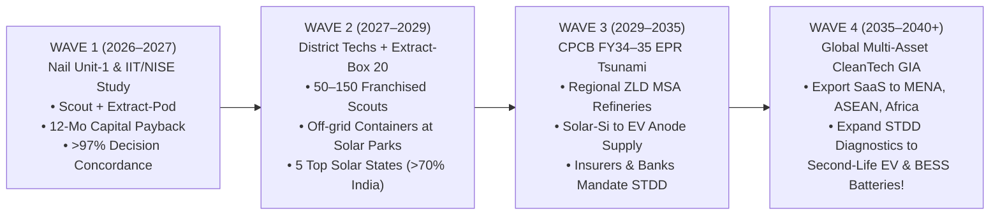

# THE SUNSECOND (STDD) MASTER PROJECT BIBLE
## The "GIA for Solar": Integrated Second-Life Qualification, Managed Liquidity & Toxin-Free Resource Extraction Platform

| Academic & Venture Control | Specification |
| :--- | :--- |
| **Project Name** | **SunSecond** *(SunSecond STDD — Standardized Solar Lifecycle, Liquidity & Extraction Ecosystem)* |
| **Subject / Course** | **BEC754 — Start-up and Entrepreneurial Activity Assessment** |
| **Branch / Department** | **Electronics Engineering** |
| **Institution** | **Rajkiya Engineering College, Sonbhadra** |
| **Team Members** | **1. Neeraj** (Roll No.: `2308410300042`) **2. Pankaj** (Roll No.: `2308410300044`) |
| **Geographic Scope** | India Solar-Belt Launchpad (including Sonbhadra / Eastern UP Energy Corridor Pilot) $\rightarrow$ Global Scale |
| **Edition** | **Version 3.1 (Final Academic & Venture Master Blueprint)** |

---

> ### THE UNIFYING PRINCIPLE
> **"Test First. Reuse Every Safe Watt. Extract Every Gram From What Cannot Be Reused."**
>
> *When **SunSecond STDD** certifies a panel reusable, the market buys it without hesitation. When **SunSecond STDD** condemns a panel unsafe, the owner surrenders it directly to us with zero friction.*

---

## Executive Master Scorecard

| Pillar | Core Metric / Architectural Specification |
| :--- | :--- |
| **The Global & Indian Opportunity** | **78M+ tonnes** global PV waste by 2050; India surges to **340,000 tonnes (2030)** $\rightarrow$ **4.5M tonnes (2040)** backed by mandatory **CPCB Category CEEW-14 EPR** rules |
| **Brand & Market Moat** | **GIA** (unquestioned cryptographic 4S grading authority) + **StockX / Cashify** (instant on-site liquidity & escrow) |
| **Diagnostic Breakthrough** | Decision-first NDE sensor fusion (**Dark I-V + AC-IS + 365 nm UVF + Active Thermal + Rapid Mist Wet-Leakage + Portable NIR**) @ **₹42–₹85/panel** vs. ₹2 Crore commercial mobile labs |
| **Toxin-Free Extraction Breakthrough** | **Dual-Path Delamination** (PID Hot-Knife ~285°C intact glass + Dry Roller/Water-Jet shattered glass) + **Closed-Loop Biodegradable MSA + Electrowinning** (99.9% Silver, Zero \(\text{NO}_x\)/HF) + **EV Battery Si-Anode Upcycling** |
| **Modular Hardware Suites** | **Testing**: `Scout` (Backpack), `Express-Van`, `Vault-Hub` \| **Scrapping**: `Extract-Pod` (Pickup), `Extract-Box 20` (Solar Container — **88% freight weight cut**), `Extract-Refinery` (ZLD Hub) |
| **Unit-1 Launch Capital** | **₹23.00 Lakh (~\$27,500)** all-in (**₹15L** dual-sector setup + **₹8L** working capital) *(Ultra-lean student/grant pilot: ₹8.5–₹10L)* |
| **Unit-1 Monthly Economics** | **₹3.00 Lakh/mo OpEx** \| Break-Even: **360 panels/mo (Month 4)** \| Steady Profit (800 panels/mo): **₹3.70 Lakh/mo (₹44.4L/yr)** |
| **Payback & Return on Capital** | **11–13 Months Full Capital Payback** \| **~193% Annualized Cash-on-Cash ROI** |
| **Scrap Profit Pivot** | Flips CEEW's **-₹10,230/tonne** standalone loss into **+₹62,500/tonne (Phase 1)** $\rightarrow$ **+₹98,000/tonne (Phase 2)** |
| **5-Year Wealth & Scale Horizon** | **₹110 Crore ARR \| ₹40 Crore EBITDA \| ₹500–₹700 Crore Valuation** (15 hubs + 600 techs + national label licensing + BESS expansion) |

---

## Master Navigation Flow

* [**PART I: THE CRISIS, REGULATORY CATALYST & MARKET OPPORTUNITY**](#part-i-the-crisis-regulatory-catalyst--market-opportunity)
* [**PART II: BRAND IDENTITY & THE "GIA FOR SOLAR" TRUST ARCHITECTURE**](#part-ii-brand-identity--the-gia-for-solar-trust-architecture)
* [**PART III: END-TO-END TECHNICAL & HARDWARE ARCHITECTURE**](#part-iii-end-to-end-technical--hardware-architecture)
  * *3.1 Integrated System Flow* \| *3.2 Decision-First Diagnostic Science (11 NDE Methods)* \| *3.3 Three Testing Suites* \| *3.4 Multi-Tier Cascade Reuse & Poka-Yoke* \| *3.5 Toxin-Free Extraction Science (10 Methods) & Three Scrapping Suites*
* [**PART IV: THE COMMERCIAL ENGINE & HIGH-VELOCITY MONETIZATION**](#part-iv-the-commercial-engine--high-velocity-monetization)
* [**PART V: GROUND-REALITY FINANCIALS, UNIT-1 LAUNCH & WEALTH CREATION**](#part-v-ground-reality-financials-unit-1-launch--wealth-creation)
* [**PART VI: RISK DEFENSE, GOVERNANCE & THE 2026–2040 FUTURE HORIZON**](#part-vi-risk-defense-governance--the-20262040-future-horizon)
* [**PART VII: ACADEMIC EXECUTION — ₹18,000 LAB `MVP-0` & FIELD INTERVIEW KIT**](#part-vii-academic-execution--18000-lab-mvp-0--field-interview-kit)

---

# PART I: THE CRISIS, REGULATORY CATALYST & MARKET OPPORTUNITY

## 1.1 The Inevitable Retirement Wave (India & Global)
Over **1.6 Terawatts (TW)** of solar photovoltaic (PV) panels have been installed globally, with India ranking among the top four solar markets worldwide. Although solar modules carry 25-year performance warranties, **the real retirement tsunami is arriving 10–15 years early**:
* **Utility "Re-Powering" Economics**: Utility solar parks actively rip out 10–14 year old 250W–330W polycrystalline modules to install modern 550W–700W bifacial TOPCon/HJT panels—doubling power generation on the exact same land and grid interconnection.
* **Storm, Thermal & Transport Attrition**: Extreme Indian summer heat (45°C–50°C ambient), hailstorms, and rough logistics prematurely retire millions of panels annually.
* **Quantified Waste Trajectory**:
  * **Global (IRENA)**: 4–8 million tonnes by 2030 $\rightarrow$ **78+ million metric tonnes by 2050** (>\$15 Billion recoverable raw material value).
  * **India (CEEW)**: **~340,000 metric tonnes by 2030** $\rightarrow$ **~4.5 million metric tonnes by 2040**.

## 1.2 The Anatomy Paradox: Mass vs. Economic Value
Crystalline silicon (c-Si) panels represent >95% of installed capacity and exhibit an extreme mismatch between physical mass and economic value:

| Material Layer | Mass Share (%) | Value Share (%) | Structural Reality & Value Unlock |
| :--- | :---: | :---: | :--- |
| **Low-Iron Solar Glass** | 70% – 76% | ~5% *(if shredded)* | Hammer-mills crush it into ₹2/kg contaminated dust; **Hot-Knife peeling** preserves unbroken sheets worth **₹13–₹18/kg**. |
| **Aluminum Frame (6063-T5)** | 8% – 13% | ~26% | Pure extruded alloy; commands **+35% Green Aluminum premium** from extrusion OEMs chasing EU CBAM / Scope 3 targets. |
| **EVA Encapsulant** | 5% – 7% | Negative | Cross-linked thermoset "superglue" resistant to melting; burning emits toxic VOCs/dioxins. |
| **Silicon Wafers (6N Pure)** | 3% – 5% | ~12% *(50%+ upcycled)* | Already 99.9999% semiconductor purity; upcycling to **EV Li-Ion battery silicon anodes** multiplies value **5×–10×**. |
| **Backsheet (PET / PVDF)** | 1.5% – 2.5% | Zero / Hazard | Fluorinated PVDF/Tedlar releases lethal **Hydrofluoric Acid (HF)** if thermally incinerated without sorting. |
| **Copper Cables & Ribbons** | ~1% | ~8% | High 48-hour liquidity; internal solder ribbons contain neurotoxic **Lead (Pb)**. |
| **Silver Paste (Ag)** | **0.05% – 0.08%** | **~47%** | Legacy 2010–2018 panels dying now hold **15–22g Ag/panel (₹1,350–₹1,980 of silver!)**. |

## 1.3 Why Today's Market Is Structurally Broken (4 Interlocking Failures)
1. **CEEW's Negative Recycling Economics**: CEEW's financial assessment proved that standalone mechanical/chemical PV recycling in India loses **₹10,230 to ₹12,431 per tonne** when operators pay for whole scrap panels, haul empty frames long distances, and shred panels into low-grade dust.
2. **The Testing Cost Wall**: Fixed IEC 17025 labs cost ₹8+ Crore; commercial mobile PV labs (e.g., *MBJ Mobile Lab 5.0*) cost **₹1.8–₹2.3 Crore** and process only 60–100 panels/day (**₹1,500–₹2,500/panel**)—completely unviable for ₹1,500–₹2,500 used panels.
3. **Dangerous Grey-Market Reuse**: 40%–55% of retired panels still produce substantial electricity, yet enter rural India untested—causing **>150°C thermal hotspot roof fires** and electrocution risks.
4. **Informal Dumping & Acid Burning**: Unorganized *kabadiwalas* strip aluminum frames and dump toxic lead-bearing glass in landfills or burn polymers in open fields.

## 1.4 The Regulatory Catalyst: India's CPCB Category CEEW-14 Mandate
Under India’s **E-Waste (Management) Rules, 2022** and **CPCB Guidelines (2025–2026)**:
* Solar PV modules/cells are legally classified under **Category CEEW-14** with mandatory **Extended Producer Responsibility (EPR)** tracking through **FY 2034–2035**.
* Open dumping and landfilling are strictly prohibited; producers and commercial power generators must maintain CPCB portal inventories and hand over waste exclusively to **registered recyclers**.
* **The Opportunity**: Legal liability + fire-insurance pressure + massive retiring volume create an immediate, underserved white space for a **trusted, fast, dual-sector lifecycle authority**.

---

# PART II: BRAND IDENTITY & THE "GIA FOR SOLAR" TRUST ARCHITECTURE

## 2.1 The Strategic Insight: One System, Two Interlocked Missions
Treating 1,000 retired panels identically destroys value. **SunSecond** unifies two missions under one ironclad rule:
* **Mission A — Second-Life Qualification & Liquidity (`SunSecond STDD` & `Bazaar`)**: Rapidly certify, repair, re-rate, and monetize every panel capable of safe electricity generation.
* **Mission B — Toxin-Free Resource Extraction (`SunSecond Extract`)**: Cleanly strip, delaminate, and recover high-purity raw materials + CPCB EPR credits from every panel that fails safety or power thresholds.

## 2.2 Solving the Trust Paradox (Zero-Human-Bias Cryptographic Grading)
When one company both *grades* and *buys/scraps* assets, owners fear false rejections and buyers fear false passes. SunSecond neutralizes this permanently via three mechanisms:
1. **On-Board Hardware Security Module (HSM)**: Every raw sensor signal (I-V curve, `Riso`, thermal map, UVF photo) is ECDSA-signed inside an embedded **ATECC608B chip** before any human views it. Technicians cannot alter grades.
2. **"Glass-Box" Visual Evidence**: Within 60 seconds, the owner receives a live WhatsApp link showing their panel's exact glowing hotspot or cracked UVF image. Visual proof eliminates argument instantly.
3. **The "Free-to-Walk" Rule**: After grading, the owner owns their certificate and is 100% free to keep the panel or sell it elsewhere. Removing coercion proves honesty—causing >80% of owners to choose SunSecond's seamless cash offer or free removal.

## 2.3 The Open "SunSecond 4S" Standard (Inventing the Industry Language)
Just as **GIA** invented the **4Cs** (Cut, Color, Clarity, Carat) and gave the language away for free so the global diamond market could only speak GIA's vocabulary, SunSecond publishes the open **4S Solar Protocol**:
1. **S1 — Safety (`PASS` / `HAZARD`)**: High-voltage dry/wet insulation resistance (`Riso`) & ground continuity.
2. **S2 — Structure (`INTACT` / `STRESSED` / `CRACKED`)**: UVF micro-crack map, glass integrity, and NIR backsheet polymer health.
3. **S3 — Silicon Health (`STRONG` / `REPAIRABLE` / `DEGRADED`)**: Dark I-V series/shunt resistance (\(R_s, R_{sh}\)), AC-IS moisture signature, and bypass diode check.
4. **S4 — Service Band (`SS-A+`, `SS-A`, `SS-R`, `SS-B`, `SS-F`)**: Guaranteed true-wattage tier & maximum allowed DC voltage.

## 2.4 The 5-Step Playbook to Become the Unchallenged Standard

Once **Fire Insurers** require a SunSecond certificate to cover commercial roofs, **Rural NBFCs / NABARD** finance only SunSecond-QR solar pumps, **EPCs** embed SunSecond into repowering contracts, and **CPCB Recyclers** rely on SunSecond's HSM mass-balance manifests—**SunSecond achieves an unbreakable 4-sided trust monopoly**.

---

# PART III: END-TO-END TECHNICAL & HARDWARE ARCHITECTURE

## 3.1 The Unified SunSecond Machine (Physical-to-Digital Flow)

---

## 3.2 Decision-First Diagnostic Science (11 Advanced NDE Technologies)

**Core Engineering Breakthrough**: SunSecond abandons expensive \(\pm 0.5\%\) factory numeric metrology in favor of **>98% classification accuracy** across *Safety, Structure, Silicon Health, and Power Band*—operating in **<45 seconds per panel, day or night, rain or shine**.

> [!CAUTION]
> **The 14% Hidden Safety Trap (CSIRO & IEA PVPS Task 13 Finding)**: Empirical testing of thousands of retired panels proved that **14%–15% of panels that pass BOTH I-V power curves AND Electroluminescence (EL) still FAIL wet-leakage electrical safety tests ("Dry Pass / Wet Fail")**. Electrical insulation (`Riso`) is therefore SunSecond's mandatory Gate 1.

| Domain | # | Technology / Method | Faults Caught & Strategic Value | Speed | Sun Needed? | Hardware Cost |
| :--- | :---: | :--- | :--- | :---: | :---: | :---: |
| **A. Safety Veto** | 1 | **Dry Hi-Pot (`Riso,dry`)** | Frame shorts, punctured backsheets (IEC 61730) — instant rooftop veto | 3s | No | ₹15k–₹35k |
| | 2 | **Rapid Conductive-Mist Wet Leakage (`Riso,wet`)** | Surfactant-wetted conductive foam/mist bed replaces 10-min water tank; catches **14% Dry-Pass/Wet-Fail trap** (\(>40\text{ M}\Omega\cdot\text{m}^2\)) | 15–20s | No | ₹40k–₹80k |
| | 3 | **Partial Discharge (PD) / Capacitive Transient** | Filters parasitic module capacitance spikes; catches internal EVA micro-voids & arcing paths | 3s | No | In Hi-Pot |
| **B. Electrical Fingerprinting** | 4 | **Dark I-V Sweep + Bypass Diode Pulse** | Sweeps panel as diode matrix in shade; isolates \(R_s\) (solder fatigue), \(R_{sh}\) (PID/shunts), \(n\), and **₹150 repairable diodes (`SS-R`)** | **2s** | **NO** | ₹25k–₹60k |
| | 5 | **AC Impedance Spectroscopy (AC-IS)** | 10 Hz–100 kHz AC sweep; Nyquist plots catch **moisture ingress** (capacitance shift) & **early solder intermetallic corrosion** | 3s | **NO** | In Dark I-V DSP |
| | 6 | **SSTDR (Live-String Radar)** | Injects pseudo-noise RF code into live 1000V strings; locates bad connectors/ribbons before unmounting | 10s/str | Live | ₹1.2L–₹2.5L |
| | 7 | **2-Sec Reference Optical / Mini-Flash** | Closes Dark I-V's sole blind spot: detects EVA browning / glass opacity loss (\(\pm 4\%\) band accuracy) | 3s | Amb/LED | ₹15k–₹30k |
| **C. Visual Proof** | 8 | **365 nm UV Fluorescence (UVF)** | **NREL/Fraunhofer EL-Killer**: Aged EVA glows yellow-green; oxygen along cell cracks photobleaches them into **sharp dark lines**. Zero wiring! | **5s** | Shade hood | **₹5k–₹15k** |
| | 9 | **Active Pulse Thermography** | 3-sec DC current pulse + 256×192 LWIR camera exposes glowing hotspots indoors/at night (**#1 visual trust tool**) | 8s | **NO** | ₹20k–₹45k |
| | 10 | **Daylight Lock-In PL / EL (UNSW)** | Modulated current/inverter switching + differential NIR frame subtraction cancels midday sunlight; spots fresh cracks | 10s | Daylight | ₹2.5L–₹5L |
| **D. Chemistry** | 11 | **Portable NIR Spectroscopy (900–1700 nm)** | 3-sec touch probe (TI DLP NIRscan Nano + ML): flags brittle Polyamide/AAA backsheets **AND** separates fluorinated PVDF vs. PET scrap | 3s | **NO** | ₹1.5L–₹3L |

### Sensor-Fusion Blind-Spot Elimination Matrix
* **Dark I-V is blind to yellowed glass** $\rightarrow$ Covered by 2-sec Optical Check & UVF hue!
* **UVF cannot see fresh transport cracks (<3 mo)** $\rightarrow$ Covered by Dark I-V \(R_s\) jump, Active Thermal & Hub EL!
* **Dry Hi-Pot misses 14% moisture paths** $\rightarrow$ Covered by Rapid Mist Wet-Leakage (`Riso,wet`) & AC-IS moisture capacitance!
* **Combined Multi-Modal Decision Accuracy**: **98.5%–99.5%** at **< ₹85/panel**.

---

## 3.3 The Three Modular Testing Suites (Right-Sized Portability)

| Testing Suite | Form Factor & Target | Core Hardware & Custom Electronics | CapEx | Throughput | Test Cost / Panel |
| :--- | :--- | :--- | :---: | :---: | :---: |
| **1. `SunSecond Scout`** *(Ultra-Portable)* | 6.5 kg Motorbike Backpack \| Homes, Farmers, Shops (1–30 panels) | Custom **`PFA-1` Box** (Dual-core **STM32H7** DSP, 0–60V/15A MOSFET Dark I-V/AC-IS driver, 1000V flyback Megger, **ATECC608B HSM**, 48V LFP battery) + Pop-up 365 nm UVF Hood + USB-C LWIR Thermal + Ref Photodiode | **₹1.2–₹1.5 Lakh** | 80–120 / day *(30s/panel)* | **~₹75** |
| **2. `SunSecond Express-Van`** *(Semi-Portable)* | Autonomous Solar/LFP Commercial Van \| Factories & EPC Repowering (50–2,000 panels) | `Scout` Core + **SSTDR String Radar** + **2-Panel Surfactant-Mist Wet-Leakage Drawer** + **Daylight Lock-In EL** + **Portable NIR Probe** + Laser QR Printer | **₹12–₹16 Lakh** *(12× cheaper than MBJ!)* | 250–400 / day | **~₹55** |
| **3. `SunSecond Vault-Hub`** *(Fixed Regional Tunnel)* | City Hub Conveyor \| Bankable 5-Yr Warranted Pallets & Bulk Sorting | Wash $\rightarrow$ Parallel 4-Panel IEC Wet-Leakage Bed $\rightarrow$ Enclosed **Multi-Spectral LED Flash (\(\pm 2\%\)) + High-Res EL Tunnel** $\rightarrow$ Smart J-Box Repair Bench $\rightarrow$ Auto \(I_{mpp}\) Binner | **₹28–₹35 Lakh** | 600–1,000 / day | **~₹42** |

---

## 3.4 Multi-Tier Cascade Reuse & Hardware *Poka-Yoke* (Mistake-Proofing)

GIA never loses reputation grading budget diamonds because **every grade states the exact truth**. SunSecond extracts every safe watt across 4 positive tiers while enforcing a strict safety red line:

| Grade | Verified Condition | Target Indian & Global Applications | Electronics Engineering Enabler | Pricing & Warranty |
| :--- | :--- | :--- | :--- | :--- |
| **`SS-A+` (Prime)** | 80%–90% power; full `Riso,wet` pass; zero severe cracks | SME factories, cold storage, dairy chillers, petrol pumps, EV sheds (commercial tariffs ₹9–₹14/kWh $\rightarrow$ <1.8 yr payback) | Full Hub qualification + 1000V DC string rating | **₹10–₹13/W** \| 3–5 Yr Insured Swap |
| **`SS-A` (Workhorse)** | 65%–80% power; safe insulation; mild uniform aging | Agricultural solar pumps, poultry farms, *atta chakkis*, brick kilns, telecom towers, rural microgrids | **Automated \(I_{mpp}\) Current-Binning** (\(\pm 0.25\text{ A}\) matched pallets = zero series mismatch loss) | **₹8–₹10/W** \| 2 Yr Replacement |
| **`SS-R` (Repairable)** | >70% healthy cells, dead bypass diode / burnt J-box | Promoted to `SS-A` after ₹250 fix (**>240% gross margin!**) | **Active Ideal-Diode Smart J-Box** (MOSFETs drop 15 mV vs. overheating Schottky diodes) | Promoted to `SS-A` |
| **`SS-B` (SELV Micro-DC)** | 45%–65% power OR **1 dead substring** (2 healthy substrings = 150–190W @ 24V) | **STRICTLY <60V DC Standalone**: Kirana 12V inverter charging, E-rickshaw 48V roofs, farm *jhatka* fences, streetlights, pond aerators, IoT | Isolate dead substring + deploy strictly in **SELV (<60V DC)** where electrocution & arc-fire risk drops to ~0 | **₹6–₹8/W** (or ₹4,499 Power Kits) \| 1 Yr Swap |
| **`SS-F` (Condemned)** | **<45% power OR ANY safety/insulation/hotspot/glass failure** *(even at 85% output!)* | **ZERO electrical reuse** (never cut silicon cells out of EVA) $\rightarrow$ `SunSecond Extract` | Flush-cut MC4 leads on-site + Lock cloud QR **`DANGER: CONDEMNED`** | CPCB EPR Handover |

**Three Anti-Fraud Hardware Controls (*Poka-Yoke*)**:
1. **Tamper-Evident True-Wattage Plate**: Permanently covers the old factory `330W` sticker with guaranteed real output (e.g., `SunSecond Certified: 175W ±5% | Max 60V DC ONLY`; leaves `VOID` pattern if peeled).
2. **Physical Connector Keying**: Tier 3 (`SS-B`) swaps 1000V MC4 plugs for **keyed 60V XT60 / Anderson plugs**—making it physically impossible to plug a degraded panel into a 1000V commercial inverter.
3. **Color-Coded Seals**: **GREEN** (`SS-A+`/`SS-A`), **AMBER** (`SS-B` <60V Only), **RED Perforated** (`SS-F` Condemned).

---

## 3.5 Toxin-Free Extraction Science (10 Methods) & The Three Scrapping Suites

Roughly **65%–70%** of `SS-F` panels arrive with **intact glass** and **30%–35%** with **shattered glass**. SunSecond deploys a **Dual-Path Clean Delamination Engine** paired with **Toxin-Free Closed-Loop Electrochemistry**—strictly banning hammer-mills, open pyrolysis, and Nitric Acid.

| Method / Tech | Physics & Role | Toxin-Free | Speed / Panel | India CapEx | **SunSecond Verdict** |
| :--- | :--- | :---: | :---: | :---: | :--- |
| **1. Pneumatic Frame & J-Box Stripper** | Pulls pure 6063-T5 Al rails + shears Cu J-box (100% dry) | ★★★★★ | 35s | ₹3.5L | ✅ **ADOPT DAY 1** |
| **2. Portable NIR Chemistry Gate** | Separates PET vs. fluorinated PVDF (zero HF hazard) vs. CdTe | ★★★★★ | 3s | ₹2.0L | ✅ **ADOPT PHASE 1** |
| **3. Path A (Intact): `Hot-Knife` Peeler** | PID blade at **~285°C** (below EVA pyrolysis) yields **unbroken flat solar glass (6×–9× value)** | ★★★★★ | 45–60s | ₹18L–₹28L | ✅ **ADOPT PHASE 2** |
| **4. Path B (Shattered): Roller / Water-Jet** | Diamond micro-rollers w/ HEPA suction or closed-loop water-jet strips glass shards cleanly | ★★★★☆ | 60s | ₹15L–₹22L | ✅ **ADOPT PHASE 2** |
| **5. Green MSA + Electrowinning (Ag)** | Biodegradable **Methanesulfonic Acid + \(\text{H}_2\text{O}_2\)** dissolves 95–99% Ag w/ **zero \(\text{NO}_x\)**; potentiostat plates **99.9% Ag** & regenerates acid (ZLD!) | ★★★★★ | Inline Batch | ₹45L–₹80L | ✅ **PARTNER PH-1 $\rightarrow$ OWN PH-2/3** |
| **6. Dry Electrostatic & Eddy-Current** | Splits polymer flakes from Cu-Sn busbars & pure 6N silicon (>98% purity) | ★★★★★ | Continuous | ₹12L–₹18L | ✅ **ADOPT PHASE 2/3** |
| **7. Solar-Si $\rightarrow$ EV Battery Anodes** | Ball-mills & carbon-coats 6N solar silicon into Li-Ion **Si-C anode precursor** (5×–10× value) | ★★★★★ | Batch | Partner/Ph-3 | ✅ **SCALE PHASE 3** |
| **8. HVPF (SELFRAG High-Voltage Pulse)** | 100–200 kV underwater nanosecond shockwaves liberate along dielectric interfaces | ★★★★★ | Batch | High | ⏳ **DEFER TO PHASE 3** |
| **9. Laser / HIPL Optical Debonding** | Millisecond photonic flash pops glass-EVA bond via \(\text{SiN}_x\) absorption | ★★★★★ | 20–30s | High | ⏳ **R&D WATCH (2028+)** |
| **10. Shredding / Pyrolysis / Nitric / \(\text{LN}_2\)** | Shredding loses ₹10k/t; Pyrolysis/Nitric emit toxic HF/\(\text{NO}_x\); Cryogenic OpEx too costly | ❌ | Varies | Varies | ❌ **STRICTLY BANNED** |

**Closed-Loop Toxin-Free Silver Leaching Chemistry (Zero \(\text{NO}_x\) Fumes, ZLD)**:
$$2\text{Ag} + \text{H}_2\text{O}_2 + 2\text{CH}_3\text{SO}_3\text{H} \longrightarrow 2\text{Ag}^+ + 2(\text{CH}_3\text{SO}_3)^- + 2\text{H}_2\text{O}$$

### The Three Modular Scrapping Suites (Cutting Logistics Weight 65%–88%)

| Scrapping Suite | Deployment & Tools | CapEx | Throughput | Freight Cut | Net Profit / Panel | Payback |
| :--- | :--- | :---: | :---: | :---: | :---: | :---: |
| **1. `Extract-Pod`** *(Pickup / Spoke)* | Day-1 Unit-1 kit: Pneumatic 6063 Al puller, J-box shear, HSM load-cell scale | **₹4.5–₹6.0L** | 30–40 / hr | **65% vol** | **+₹650** *(Ph-1 Tolling)* | **3–4 Mo** |
| **2. `Extract-Box 20`** *(20-ft Solar Container)* | Autonomous PV+LFP container deployed directly to utility solar parks: Auto stripper + NIR + **Inline Hot-Knife Glass Peeler** (Glass ships to local furnace; **only 1.2 kg/panel Ag-Si concentrate** travels to refinery — 8,000 panels/truck!) | **₹28–₹42L** | 100–120 / hr | **88% wt** | **+₹1,250** | **7–9 Mo** |
| **3. `Extract-Refinery`** *(Regional ZLD Hub)* | Phase 2/3 Hub (5,000–10,000 t/yr): Dual Intact/Shattered delamination + Closed-Loop MSA Electrowinning + EV-Si milling | **₹1.5–₹2.5 Cr** | 5k–10k t/yr | Regional | **+₹1,960** | **12–16 Mo** |

**Embedded Electronics Controls Guaranteeing GIA-Grade Cleanliness**:
* **STM32/PLC Thermal-Torque PID** holds Hot-Knife strictly at **285°C \(\pm\) 3°C** and retracts in 20 ms on hidden cracks.
* **MEMS HF & VOC Air-Safety Interlock** auto-halts heaters if fluorinated PVDF spikes >1 ppm.
* **Potentiostat CV/CC Buck Rectifier** selectively plates **99.9% Ag** while isolating Cu/Pb.
* **HSM-Signed Automated Load-Cell Conveyors** cryptographically prove mass balance onto the CPCB EPR portal:
  $$W_{\text{input}} = W_{\text{Al}} + W_{\text{Cu}} + W_{\text{Glass}} + W_{\text{Ag-Si}} + W_{\text{Polymer}} \quad (\pm 1\%)$$

---

# PART IV: THE COMMERCIAL ENGINE & HIGH-VELOCITY MONETIZATION

## 4.1 The "StockX + Spinny + GIA" 3-Engine Platform
Ordinary buyers (farmers, shopkeepers, SME owners) do not buy `Impp` specs—they buy **guaranteed monthly electricity savings**. `SunSecond.in` (Web + WhatsApp) provides a **3-Click Outcome Wizard** (*What do you want to power? $\rightarrow$ How much space? $\rightarrow$ Pick Savings & Warranty*) powered by three synchronized cash engines:
1. **Engine 1 — Verify-to-Ship Managed Marketplace (StockX Model | 0% Inventory Risk)**: Sellers list SunSecond-certified panels; buyer funds stay in **Escrow** and release only after the buyer scans the tamper-proof NFC/QR seal upon delivery (**12%–18% commission**).
2. **Engine 2 — Proprietary Cherry-Pick Repairs & Plug-and-Play Power Kits (Spinny Model | 50%–240% Margin)**: Use SunSecond cash *only* on `SS-R` diode repairs and pre-wired **Outcome Power Boxes** (e.g., 2× `SS-B` 175W panels + 20A controller + keyed XT60 cables sold for **₹4,499**—doubling profit while eliminating wiring errors).
3. **Engine 3 — Pure-Profit GIA Label Licensing & Technician SaaS (80%–90% Margin)**: Lease `Scout` kits to independent electricians (**₹3,999/mo + ₹50/certificate**) and license tamper-proof STDD badges to EPCs/refurbishers (**₹150–₹250/panel**).

## 4.2 The 10 Stacked Revenue Streams & Zero-Cheat Psychology

| # | Revenue Stream | Pricing Mechanism | Gross Margin | Cash Speed |
| :---: | :--- | :--- | :---: | :---: |
| 1 | **On-Site Testing & STDD Audit** | ₹149–₹249/panel (Home) \| ₹99–₹150/panel (Bulk); waived on buyback | 65% | Day 0 |
| 2 | **Managed Marketplace Escrow** | 12%–18% commission on seller-owned certified panels | 85% | 7–14 Days |
| 3 | **`SS-R` Repair Arbitrage** | Buy dead-diode panels @ ₹450 $\rightarrow$ ₹250 fix $\rightarrow$ sell @ ₹2,100–₹2,600 | 70%+ | 15–20 Days |
| 4 | **Plug-and-Play Power Kits** | 35%–45% bundle markup on pre-wired controllers, cables & stands | 45%–55% | Instant–15d |
| 5 | **GIA Label Licensing ("STDD Inside")** | ₹0.50–₹1.00/W (₹150–₹250/panel) for official tamper-proof seals | 90% | Day 0 |
| 6 | **Technician `Scout` SaaS Franchise** | ₹3,999/mo hardware lease + ₹50/cryptographic certificate API fee | 80% | Monthly |
| 7 | **Extended Warranty Shield** | Optional 3–5 yr swap shield (₹399–₹699/panel; <1.5% actuarial failure) | 75%+ | Day 0 |
| 8 | **Embedded NBFC EMI Fintech** | 3%–5% loan referral fee from rural/SME NBFC partners (3× conversion) | 95% | Day 1 |
| 9 | **48-Hr Spoke Metal Liquidation (`SS-F`)** | Paid compliance intake + instant Green 6063 Al & Cu cash | 60% | 2 Days |
| 10 | **Clean Refining, EPR & Carbon Credits** | Hot-Knife glass + MSA Ag + EV-Si share + CPCB CEEW-14 EPR + CCTS Carbon | 50%–70% | 30–45 Days |

**Why Neither Side Ever Feels Cheated**: SunSecond publishes a live **"Solar Blue Book"** (transparent daily ₹/W rates) and offers sellers a **Two-Door Choice**—*Door 1: Instant UPI Cash Today* (70–75% of retail) OR *Door 2: List at 100% Retail* (15% fee only upon sale). Buyers pay strictly per **Verified True Watt** under Escrow protection.

## 4.3 Scrap Unit Economics Proof: Flipping CEEW's Loss Into Profit (Per Tonne / 50 Panels)

| Line Item (Per Metric Tonne `SS-F`) | Illegal *Kabadiwala* | Conventional Shredding *(CEEW)* | **SunSecond Extract — Ph 1 (`Extract-Pod` + Tolling)** | **SunSecond Extract — Ph 2 (`Extract-Box` / `Refinery` + EV-Si)** |
| :--- | :---: | :---: | :---: | :---: |
| **Feedstock Cost / Compliance Fee** | -₹15,000 | -₹10,000 | **+₹5,000** *(Net Avg Fee)* | **+₹7,500** *(Enterprise ESG)* |
| **Green Aluminum (115 kg) & Cu (18 kg)** | +₹22,000 | +₹24,000 | **+₹32,000** *(6063 Premium)* | **+₹34,000** *(6063 Premium)* |
| **Low-Iron Solar Glass (725 kg)** | ₹0 | +₹1,500 | **+₹9,500** *(Clean Cullet)* | **+₹12,500** *(Solar Sheet)* |
| **Legacy Silver (~750–900g/tonne)** | ₹0 | +₹22,000 | **+₹55,000** *(Tolling Share)* | **+₹68,000** *(MSA Electrowin)* |
| **6N Silicon (~32 kg/tonne)** | ₹0 | +₹3,500 | **+₹6,500** *(Met-Si / Kerf)* | **+₹28,000** *(EV Si-Anode)* |
| **CPCB EPR + CCTS Carbon Credits** | ₹0 | ₹0 | **+₹12,500** | **+₹16,000** |
| **Logistics, Strip & Refining Cost** | -₹3,000 | -₹61,230 | **-₹58,000** | **-₹68,000** |
| **NET PROFIT / (LOSS) PER TONNE** | *+₹4,000 (Illegal)* | **-₹10,230 (LOSS)** | **+₹62,500 (+₹1,250/panel)** | **+₹98,000 (+₹1,960/panel)** |

---

# PART V: GROUND-REALITY FINANCIALS, UNIT-1 LAUNCH & WEALTH CREATION

## 5.1 Unit-1 Launch Blueprint (Minimum Complete Dual-Sector Hub)
* **Launch Belt**: Industrial outskirt of **Ahmedabad/Sanand (Gujarat)**, **Jaipur (Rajasthan)**, or **Pune/Chakan (Maharashtra)** (3–5 GW installed within 150 km $\rightarrow$ ~1,50,000+ retiring panels/year; Unit-1 requires just **800 panels/month**, <6.5% local capture).
* **Day-1 CapEx Discipline**: Deploy `Scout` + `Extract-Pod` + `SS-R` Repair in-house; toll Stage-3 chemical silver/silicon refining through a CPCB-registered partner until Volume justifies `Extract-Box 20` and `Extract-Refinery`.

### Minimum Initial Capital Required: ₹23.00 Lakh (~\$27,500 USD)

| Setup Category | Exact Unit-1 Assets & Infrastructure | Capital (₹) |
| :--- | :--- | :---: |
| **1. Testing & STDD Hardware** | 2× `Scout` Backpack Kits (₹2.80L) + 1× Spoke Rapid Mist Wet-Leakage & Ref Flasher Bench (₹1.80L) | **₹4,60,000** |
| **2. `Extract-Pod` & Repair Lab** | Pneumatic 6063 Al Frame Puller + J-Box Shear + Glass Table + Load-Cell Scale (₹3.50L) + Repair Bench & NFC/QR Printer (₹0.90L) | **₹4,40,000** |
| **3. Facility & Logistics** | 2,200 sq ft Shed Deposit (3 mo @ ₹40k) + Racks/Pallet Jack (₹2.00L) + Pickup Van Downpayment & Padded A-Frame Racks (₹2.20L) | **₹4,20,000** |
| **4. Legal, CPCB MoU & Software** | Pvt Ltd, GST, SPCB Collection Auth, CPCB Recycler MoU, Cloud Ledger & WhatsApp Outcome Bot MVP | **₹1,80,000** |
| **FIXED SETUP CAPEX SUBTOTAL** | **Complete Dual-Sector Operational Hub** | **₹15,00,000** |
| **5. Working Capital & Buffer** | Instant UPI Buyback Float (₹4.00L) + 3-Month Survival Runway (₹4.00L) | **₹8,00,000** |
| **GRAND TOTAL LAUNCH CAPITAL** | **All-In Minimum Budget** *(Ultra-lean DST NIDHI-PRAYAS Student Grant Path: ₹8.5–₹10L)* | **₹23,00,000** |

## 5.2 Day-to-Day Running Costs (Fixed Monthly OpEx = ₹3.00 Lakh)

| Monthly Operating Head | Breakdown | Monthly Cost (₹) |
| :--- | :--- | :---: |
| **Workshop Rent** | 2,200 sq ft industrial outskirt shed (3-phase power) | ₹40,000 |
| **Core Team Payroll (6 + Founder)** | 2 Field Techs (₹44k) + 2 Workshop Staff (₹36k) + 1 Ops/Sales (₹30k) + 1 Driver (₹18k) + Founder Stipend (₹30k) | ₹1,58,000 |
| **Pickup Van Operations** | EMI (₹16k) + Diesel/EV Charging (₹20k) + Maintenance/Tolls (₹6k) | ₹42,000 |
| **Utilities & Cloud Stack** | Electricity, Water, Fiber, Cloud Server, WhatsApp Business API | ₹18,000 |
| **Consumables & Outreach** | Tamper NFC/QR Seals, Packaging, EPC Outreach, Rural Meta/WhatsApp Ads | ₹22,000 |
| **Insurance & Warranty Reserve** | Facility Fire/Liability Insurance + Baseline Swap Reserve | ₹20,000 |
| **TOTAL MONTHLY OPEX** | **Fixed Monthly Burn** | **₹3,00,000 / mo** |

## 5.3 Conservative Monthly P&L, Break-Even & Payback Curve (800 Panels/Mo)

| Monthly Revenue Stream (800 Panels) | Volume | Conservative Net Contribution / Panel | Monthly Cash (₹) |
| :--- | :---: | :---: | :---: |
| Managed Marketplace Resale (`SS-A`/`SS-B`) | 150 | ₹315 *(15% commission on ₹2,100 avg)* | ₹47,250 |
| Direct Buyback & Plug-and-Play Power Kits | 150 | ₹950 *(Net after buyback, controller, cables)* | ₹1,42,500 |
| Repair Arbitrage (`SS-R` $\rightarrow$ `SS-A`) | 100 | ₹1,400 *(Buy ₹450 + Fix ₹250; Sell ₹2,100)* | ₹1,40,000 |
| Condemned Scrap (`SS-F` Phase-1 `Extract-Pod`) | 400 | ₹650 *(Al/Cu + Partner Tolling/EPR − Cost)* | ₹2,60,000 |
| Net Non-Waived Testing & Audit Fees | 800 | ₹100 *(Blended average)* | ₹80,000 |
| **TOTAL MONTHLY GROSS CONTRIBUTION** | **800** | **₹837.2 blended avg / panel** | **₹6,69,750** |
| **Less: Fixed Monthly Running Cost (OpEx)** | | | **-₹3,00,000** |
| **NET MONTHLY OPERATING PROFIT (EBITDA)** | | **55.2% Contribution-to-EBITDA Margin** | **₹3,69,750 / mo** |

* **Operational Break-Even**: \(\frac{₹3,00,000}{₹837.2} \approx \) **360 panels/month (~14 panels/working day)** $\rightarrow$ Reached in **Month 4**.
* **Full ₹23 Lakh Capital Payback**: **11–13 Months** \| **Steady-State Annual Profit**: **₹44.4 Lakh/yr** \| **Cash-on-Cash ROI**: **~193%**.

## 5.4 Generational Wealth Creation (Scrapyard 3× vs. GIA Platform 15× Multiple)

| Milestone | Physical & Digital Footprint | Annual Revenue | Net EBITDA | Indicative Valuation | Founder Equity Wealth (60%–70%) |
| :--- | :--- | :---: | :---: | :---: | :---: |
| **Year 1** | Unit-1 (`Scout` + `Extract-Pod`) + 2 Techs | ₹65 Lakh | ₹12 Lakh | ₹3–₹5 Crore *(Seed)* | ₹2–₹3.5 Crore |
| **Year 3** | 5 Solar-Belt Hubs + 150 Franchise Techs + 2 `Extract-Box 20` Units | ₹24 Crore | ₹7.5 Crore | **₹90–₹120 Crore** *(Series A)* | **₹55–₹75 Crore** |
| **Year 5** | 15 Hubs + 600 Techs + 2 Regional `Extract-Refineries` + National Licensing | ₹110 Crore | ₹40 Crore | **₹500–₹700 Crore** *(Pre-IPO)* | **₹250–₹350+ Crore** |

---

# PART VI: RISK DEFENSE, GOVERNANCE & THE 2026–2040 FUTURE HORIZON

## 6.1 The 5-Rule "Zero-Brand-Damage" Governance Firewall
1. **Zero Coercion**: Owners receive HSM-signed thermal/insulation failure proof on WhatsApp and remain 100% free to decline handover.
2. **Irreversible On-Site Neutralization**: Condemned `SS-F` panels have MC4 leads cut flush on-site and cloud QRs permanently locked as **`DANGER — CONDEMNED SCRAP`** (zero grey-market leakage).
3. **Public Mass-Balance Audit**: HSM-signed scales reconcile every input kilogram to outputs (0.0 kg landfilled).
4. **Zero Informal Acid-Burners**: 100% CPCB-registered ZLD downstream partners; Portable NIR isolates fluorinated PVDF & thin-film CdTe.
5. **Structural Division Firewall**: `SunSecond STDD Labs` (Judge) audited independently from `SunSecond Bazaar` & `Extract` (Traders).

## 6.2 Six Brutal Real-World Risks & Ground-Level Defenses

| Real-World Risk | Operational Threat | SunSecond's Concrete Defense |
| :--- | :--- | :--- |
| **1. Unorganized *Kabadiwalas*** | Instant unregulated cash with zero GST/compliance cost | Outpay them on working panels (₹1,100 vs ₹400 scrap); out-comply them on factories via legal CPCB manifests & fire audits. |
| **2. Irregular Utility Supply** | Big repowering tenders arrive in lumpy waves | Lock in 25+ local commercial EPCs & insurance storm surveyors for steady weekly base load (400–500 panels/mo). |
| **3. Working Capital Crunch** | Paying cash upfront while B2B buyers pay on 60-day credit | Keep 50%+ volume on zero-inventory Managed Escrow + 48-hr Al/Cu liquidation + Day-1 NBFC EMI settlement. |
| **4. SPCB / CPCB Permit Delays** | Standalone recycler permits take 6–12 months | Operate Day 1 legally as an **Authorized Collection & Diagnostic Partner** under an existing CPCB recycler's MoU. |
| **5. Improper Buyer Wiring** | Rural buyer shorts degraded panel in 1000V inverter | Keyed 60V XT60 plugs on `SS-B` (*Poka-Yoke*), Plug-and-Play Power Kits, and QR install photo required for warranty. |
| **6. Transit Glass Breakage** | Rough roads shatter stacked panels, wiping out resale margin | Custom vertical padded A-frame glass-carrier steel racks inside the pickup van (<0.5% breakage rate). |

## 6.3 The 4-Wave Expansion & 2026–2040 CleanTech GIA Horizon

**The Ultimate Strategic Endgame**: Once SunSecond controls the diagnostic vans, trained electronics technicians, CPCB/insurer/bank trust rails, and STDD cryptographic standard, expanding from **Solar PV** into **Second-Life EV & Solar Storage Batteries (BESS) via EIS Certification & Extraction** adds a second \$50B+ circular market at near-zero customer acquisition cost.

---

# PART VII: ACADEMIC EXECUTION — ₹18,000 LAB `MVP-0` & FIELD INTERVIEW KIT

## 7.1 90-Day Electronics Engineering Capstone Prototype (`MVP-0` — REC Sonbhadra ECE Lab)

| Subsystem | College Lab Hardware Stack (Rajkiya Engineering College, Sonbhadra) | Est. Cost (₹) | Viva / Jury Proof Point (`BEC754`) |
| :--- | :--- | :---: | :--- |
| **1. Dark I-V & Diode Sweeper** | STM32G4 / ESP32-S3 + Programmable Constant-Current MOSFET Driver (IRFP260N + Op-Amp loop) + INA226 16-bit ADC + 48V Lab Supply | ₹4,500 | Sweeps retired panel in 2 seconds; plots \(\ln(I)\text{ vs }V\) extracting \(R_s, R_{sh}\) and flags dead bypass diode (`SS-R`). |
| **2. 365 nm UVF Crack Imager** | High-power 365 nm UV-A LED bar + PVC/blackout pop-up hood + smartphone camera w/ yellow long-pass filter | ₹3,500 | Reveals hidden silicon cell cracks & EVA aging in 5 seconds with zero electrical wiring. |
| **3. Active Pulse Thermography** | USB-C LWIR Thermal Module (Topdon TC001 / InfiRay P2 Pro — or borrowed from ECE lab) | ₹10,000 *(or ₹0 lab)* | Injects 3-sec DC pulse; displays glowing localized hotspots live on smartphone screen. |
| **4. Safety Gate (`Riso`)** | Standard 1000V Digital Megger *(available in REC Sonbhadra Electrical Machines Lab)* | ₹0 *(Lab)* | Demonstrates non-negotiable IEC 61730 electrical safety pass/fail gate. |
| **5. Live "4S" QR Web App** | Python/Flask or Firebase web app generating live mobile QR report with thermal + UVF photos + 4S Grade | ₹0 *(Free Tier)* | Faculty evaluators scan QR on their own phones during `BEC754` assessment to experience the **SunSecond GIA Glass-Box**. |

## 7.2 5-Stakeholder Field Validation Toolkit (Sonbhadra / Vindhya Corridor & National Discovery)

| # | Stakeholder Segment | Target # | Non-Leading Discovery Questions *(Past Behavior, Not Opinions)* | Hypothesis Validated |
| :---: | :--- | :---: | :--- | :--- |
| **1** | **Solar EPCs & O&M Managers** *(Supply)* | 5–6 | *"Where are the cracked/replaced panels from your last 2 years of jobs sitting right now? How do you document CPCB disposal for factories today?"* | Free/paid `SS-F` intake + steady weekly EPC supply |
| **2** | **SMEs / Cold Storage / Factories** *(Tier 1–2)* | 5–6 | *"What is your monthly commercial power/diesel bill? What exact proof/warranty would make you buy half-price certified used panels?"* | ₹10–₹13/W willingness + 3-yr warranty trust trigger |
| **3** | **Farmers, Kirana & E-Rickshaws** *(Tier 2–3)* | 8–10 | *"How much do you spend monthly on diesel pumps / inverter / e-rickshaw charging? Would a ₹4,499 plug-and-play solar box with 1-yr local swap work?"* | Demand for <60V `SS-B` Power Kits & NBFC EMI |
| **4** | **Local Solar Electricians** *(Franchise)* | 5 | *"How do you currently pinpoint which rooftop panel has a dead diode or hotspot? Would you lease a portable kit earning ₹150–₹250/test + commissions?"* | Asset-light `Scout` technician SaaS franchise |
| **5** | **Scrap Dealers & CPCB Recyclers** *(Downstream)* | 3–4 | *"What do you pay today for broken 20 kg panels, and what is your #1 cost? How much extra per kg for NIR-sorted, de-framed laminates?"* | 6063 Green Al pricing & Phase-1 CPCB tolling terms |

---

### Complete Supporting Research Library (Deep-Dive Appendices)
* [Appendix A — Solar Panel Afterlife, Reuse & Recycling Market Analysis](docs/appendix_a_market_analysis.md)
* [Appendix B — SunSecond STDD Strategic Positioning Blueprint](docs/appendix_b_stdd_blueprint.md)
* [Appendix C — GIA Roadmap & Decision-First Triage Science](docs/appendix_c_gia_triage_science.md)
* [Appendix D — Cascade Reuse Architecture & Detailed Interview Script](docs/appendix_d_cascade_reuse.md)
* [Appendix E — 11-Method Testing Suites & Hardware Master Architecture](docs/appendix_e_testing_suites.md)
* [Appendix F — 10-Stream Monetization & Managed Marketplace Engine](docs/appendix_f_monetization_engine.md)
* [Appendix G — SunSecond Extract: Non-Reusable Scrap Monetization](docs/appendix_g_scrap_monetization.md)
* [Appendix H — 10-Method Toxin-Free Scrapping Suites & Hardware Architecture](docs/appendix_h_scrapping_suites.md)
* [Appendix I — Unit-1 Ground-Reality Financials & Execution Plan](docs/appendix_i_unit1_financials.md)
