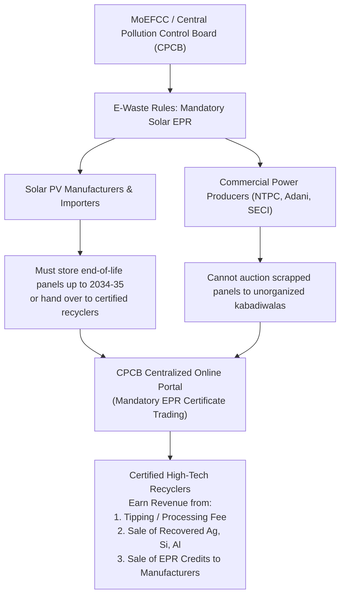
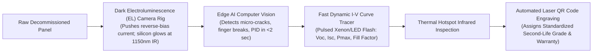
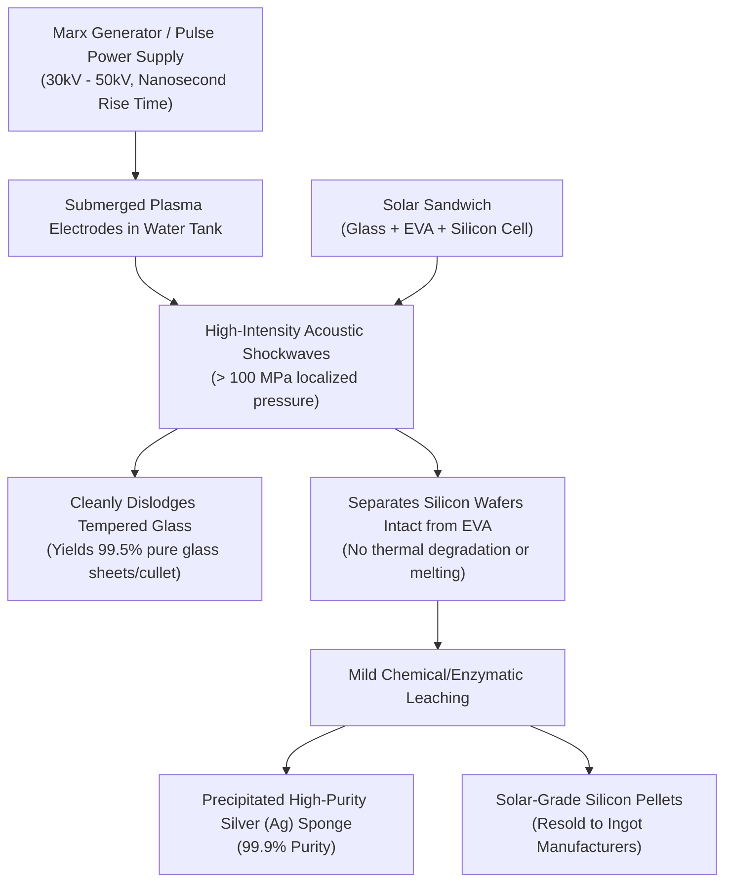
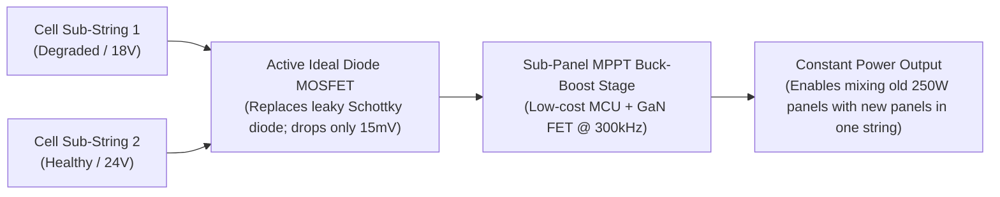
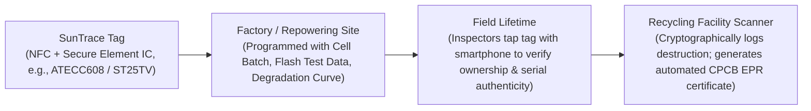

# Solar Panel After-Life, Reuse & Recycling: Market & Technical Analysis
**Project: SunSecond** | **Subject: BEC754 — Start-up and Entrepreneurial Activity Assessment**  
**Department of Electronics Engineering, Rajkiya Engineering College, Sonbhadra**  
**Team**: Neeraj (`2308410300042`) & Pankaj (`2308410300044`)

---

## 1. Executive Summary & Market Landscape

The global solar photovoltaic (PV) capacity has surpassed **1.6 Terawatts (TW)** and is expanding at an unprecedented rate. However, the first massive waves of solar installations deployed between 2005 and 2015 are now reaching their operational twilight. 

Photovoltaic modules are designed to last 25 to 30 years, but **early decommissioning is accelerating dramatically**. Utility companies frequently "re-power" existing solar parks after only 10 to 15 years to replace legacy 250W–300W polycrystalline panels with modern 550W–700W bifacial TOPCon and Heterojunction (HJT) modules, doubling generation density on the same land and grid interconnection.

```
                         GLOBAL & INDIAN PV WASTE TRAJECTORY
                                         │
        ┌────────────────────────────────┴────────────────────────────────┐
        ▼                                                                 ▼
 GLOBAL CUMULATIVE WASTE                                          INDIA PV WASTE SURGE
• 2030: 4 to 8 Million Metric Tons                               • 2030: ~340,000 Metric Tons
• 2050: 78+ Million Metric Tons                                  • 2040: ~4.5 Million Metric Tons
• Recoverable Value: > $15 Billion in                            • 4th largest global solar capacity
  Silver, Polysilicon, Copper & Aluminum                           generating massive e-waste burden
```

---

## 2. Anatomy of a Silicon PV Panel: Mass vs. Economic Value

A standard crystalline silicon (c-Si) module (accounting for >95% of the market) presents a striking **economic paradox**: the materials that make up the vast majority of its weight hold very little economic value, while the trace materials carry almost the entire financial incentive for recycling.

```
       PANEL COMPOSITION BY MASS (%)             PANEL ECONOMIC VALUE DISTRIBUTION (%)
       ┌───────────────────────────────┐         ┌───────────────────────────────┐
 Glass │████████████████████████ 76%   │  Silver │████████████████████ 47%       │
    Al │███ 10%                        │      Al │██████████ 26%                 │
   EVA │██ 6%                          │      Si │██████ 12%                     │
    Si │█ 3.5%                         │  Copper │████ 8%                        │
Polymer│█ 2.5%                         │   Glass │██ 5%                          │
Copper │ 1%                            │ Polymer │ 2%                            │
Silver │ 0.08%                         │         │                               │
       └───────────────────────────────┘         └───────────────────────────────┘
```

| Component | Mass Share (%) | Primary Function | Recycling Challenge / Hazard | Recovered Economic Value |
| :--- | :--- | :--- | :--- | :--- |
| **Solar Glass** | 70% – 76% | Low-iron tempered front protection | Contaminated by antimony (Sb) and EVA glue; downcycled to low-grade cullet. | Low (~₹1.5–₹3/kg) |
| **Aluminum Frame** | 8% – 10% | Structural rigidity | Easy to mechanically detach and smelt. | High (~₹140–₹180/kg) |
| **EVA Encapsulant** | 5% – 7% | Cross-linked thermoset waterproof sealant | Insoluble, cross-linked copolymer; binds glass to silicon like superglue. | Negative (incineration hazard) |
| **Silicon Cells** | 3% – 5% | P-N junction semiconductor wafers | Hyper-pure polysilicon (99.9999% / 6N). Crushed into useless powder by standard shredders. | High if intact (~₹800–₹1,500/kg) |
| **Backsheet** | 1.5% – 2.5% | Weatherproofing (PET/PVDF/Tedlar) | Releases toxic Hydrofluoric acid (HF) and fluorine gas if thermally incinerated. | Zero / Disposal Cost |
| **Copper Ribbon** | ~1% | Internal tinned interconnects & busbars | Coated with lead-tin (Pb-Sn) solder. | High (~₹550–₹700/kg) |
| **Silver Paste** | **0.05% – 0.08%** | Screen-printed contact fingers (\(10\text{--}20\,\text{g/panel}\)) | Intertwined at the nanoscale into the silicon surface. | **Extremely High (~45% of total value)** |
| **Lead (Pb)** | ~0.1% | Soldering alloy | Severe neurotoxin; leaches into groundwater if dumped in unlined landfills. | Toxic liability |

---

## 3. The Core Problems: Why the Industry is Broken Today

### Problem A: The "Downcycling" Trap (Crude Mechanical Recycling)
Currently, 90%+ of decommissioned panels are processed by unregulated municipal recyclers who:
1. Manually rip off the aluminum frame and tear off the junction box for copper scrap.
2. Throw the entire remaining 85% sandwich (glass + EVA + silicon + backsheet) into industrial hammer-mill shredders.
3. The result is a contaminated powder mixture of crushed glass, silicon dust, shredded plastic, and toxic lead. This mixed "cullet" cannot be remade into solar glass and is either dumped in landfills or used as low-grade asphalt filler worth less than ₹1,000/ton.

### Problem B: The Delamination Bottleneck
Ethylene Vinyl Acetate (EVA) is a cross-linked thermoset polymer designed specifically *not* to melt or degrade under 30 years of ultraviolet radiation and extreme heat. Separating the tempered glass from the silicon wafer requires:
* **Thermal Pyrolysis (>450°C)**: Consumes massive energy and releases toxic VOCs, fluorinated greenhouse gases, and hazardous air pollutants.
* **Chemical Solvents (Toluene/Trichloroethylene)**: Extremely hazardous, generates large volumes of toxic chemical sludge, and is economically unviable at scale.

### Problem C: The Unregulated "Second-Life" Grey Market
Over 40% of panels decommissioned during early utility repowering are still capable of generating **75% to 85% of their rated output**. However:
* In India, these panels flood the unorganized rural market without testing, safety certification, or warranties.
* Damaged panels with invisible internal micro-cracks or failed bypass diodes develop **localized thermal hotspots (>150°C)**, causing rooftop barn and home fires when hooked up to unmonitored off-grid agricultural pumps or inverters.

### Problem D: The Economic Deficit
Under conventional methods:
* Cost to collect, transport, dismantle, and recycle one standard panel: **\$18 to \$28 (₹1,500 – ₹2,300)**.
* Value of raw materials recovered via standard shredding (just Aluminum + low-grade glass): **\$3 to \$6 (₹250 – ₹500)**.
* **Net economic loss per panel**: **-\$15 to -\$22**, creating an immense financial barrier without government enforcement.

---

## 4. Regulatory Framework: India's Game-Changing Mandate

In late 2022, the Ministry of Environment, Forest and Climate Change (MoEFCC) notified the **E-Waste (Management) Rules, 2022**, bringing **Solar PV Modules, Panels, and Cells under Extended Producer Responsibility (EPR)** for the first time in Indian history.



* **The Market Catalyst**: Solar developers and manufacturers face massive non-compliance penalties if they do not surrender verified **EPR certificates**. This creates a paid, legally protected pipeline of scrap panels for authorized, technology-driven electronics recyclers.

---

## 5. Four Venture Concepts for Electronics Engineers

As an electronics engineer, you have a distinct unfair advantage: you understand **semiconductor physics, analog instrumentation, signal processing, power electronics, and electromagnetic fields**. Here are four venture blueprints solving this crisis:

```
                  ELECTRONICS HARDWARE OPPORTUNITIES IN SOLAR EOL
                                         │
        ┌──────────────────┬─────────────┴─────────────┬──────────────────┐
        ▼                  ▼                           ▼                  ▼
    Concept 1          Concept 2                   Concept 3          Concept 4
  "HeliCert AI"      "PulseBreak"                "OptiJBox"         "SunTrace DPP"
  Mobile Edge EL     High-Voltage Pulse          Smart Retrofit     Hardware Digital
  & I-V Diagnostic   Electrohydraulic            Optimizer for      Product Passport
  Testing Rig        Delamination System         Second-Life        (NFC/Silicon ID)
```

---

### Concept 1: HeliCert AI (Automated Mobile Diagnostic & Grading Rig for Second-Life Panels)

#### 1. The Engineering Solution
Instead of scrapping panels that still have 10–15 years of operational life, build a **mobile, van-mounted automated testing container** that travels directly to utility solar farms during repowering projects. It grades 1,000+ panels per day into three standardized tiers:
* **Grade A (80%+ Capacity, Zero Hotspots)**: Certified for domestic agricultural solar pumps and rural microgrids.
* **Grade B (70%–80% Capacity, Minor Diode/Cell Faults)**: Sold to low-income off-grid applications with power optimizers.
* **Grade C (<70% or Structural Glass Shatter)**: Routed to high-purity material recycling.



#### 2. Electronics Stack
* **Custom Dynamic Load I-V Tracer**: High-speed MOSFET electronic load with 16-bit simultaneous sampling of voltage and current using an STM32H7 or FPGA.
* **Near-Infrared (NIR) InGaAs / Modified Silicon CMOS Sensor**: Captures band-to-band radiative recombination (1,150 nm wavelength) when a 2A–8A forward bias current is driven through the panel in a dark enclosure.
* **TinyML Fault Classifier**: Convolutional neural network running on an NVIDIA Jetson Orin Nano classifying finger busbar cracks, potential-induced degradation (PID), and cell solder failure in 500 milliseconds.

#### 3. Business Model & Unit Economics
* **Revenue**: Charge solar developers **₹150 to ₹200 (\$1.80–\$2.40) per panel tested**, or buy decommissioned panels as scrap at **₹400/panel** and resell certified Grade-A panels at **₹1,800 to ₹2,500/panel** (providing rural farmers with 300W modules at 60% discount compared to new modules).
* **Payback Period**: 8 months on an initial hardware rig costing ₹18 Lakhs (\$21,500).

---

### Concept 2: PulseBreak (High-Voltage Pulse Electrohydraulic Delamination)

#### 1. The Engineering Solution
Thermal pyrolysis burns polymers and toxic backsheets; mechanical crushing turns silicon into useless dust. **Electrohydraulic Fragmentation (EHF)** uses pulsed high-voltage electrical discharges inside a water chamber to cleanly delaminate panels without chemical solvents or furnaces.



* **Core Physics**: The dielectric constants of glass, EVA, and silicon differ sharply. When a 40kV nanosecond electrical discharge propagates through water, the resulting hypersonic shockwave selectively fractures the mechanical bonds along the material interfaces (dielectric boundaries) rather than pulverizing the solid silicon bulk.

#### 2. Electronics Stack
* **Pulse Power Stage**: High-voltage Marx Generator or Magnetic Pulse Compression (MPC) circuit utilizing Silicon Carbide (SiC) switches or spark-gap triggers.
* **Energy Storage**: Low-inductance high-voltage pulse capacitors (40kV, 2–10 Joules/pulse).
* **Control Unit**: Microcontroller-driven automated electrode positioning and water conductivity conditioning loop.

#### 3. Business Model & Unit Economics
* **BOM & System CAPEX**: ₹35–₹50 Lakhs (\$42,000–\$60,000) for a 1-panel-per-minute pilot EHF machine.
* **Output Value**:
  * Recovers **15–20 grams of Silver per panel** $\rightarrow$ ₹1,200–₹1,600 value.
  * Recovers **600g of intact Silicon wafers** $\rightarrow$ ₹450 value.
  * Recovers **clean low-iron float glass** $\rightarrow$ ₹250 value.
  * Recovers **Aluminum frame** $\rightarrow$ ₹400 value.
  * Total Recovered Value: **₹2,300 to ₹2,700 (\$28–\$32) per panel**.
  * Net Operating Cost (Electricity + Water filtration): ~₹600/panel.
  * **Net Profit per panel**: **₹1,700 – ₹2,100**.

---

### Concept 3: OptiJBox (Smart Plug-and-Play Retrofit Optimizer for Degraded Panels)

#### 1. The Engineering Solution
Many panels decommissioned after 10 years are discarded simply because **one of the three internal bypass diodes in the junction box shorted out**, or because individual cell degradation creates impedance mismatch, bringing down the entire string.
* **The Product**: An ultra-low-cost, clip-on replacement junction box containing a **Synchronous Buck-Boost DC-DC MPPT Optimizer** and an active solid-state diode circuit.



#### 2. Electronics Stack
* **Active Bypass Circuit**: Replaces traditional 15A Schottky bypass diodes (which dissipate 6W–10W of heat and frequently burn out) with back-to-back N-channel MOSFETs controlled by an ideal diode controller (e.g., TI LM5050 or Analog Devices LTC4359), reducing thermal dissipation by 90%.
* **Sub-Panel MPPT Controller**: Microcontroller with embedded high-speed PWM driving a synchronous buck-boost topology, performing maximum power point tracking on individual cell strings.

#### 3. Market Opportunity
* Sells to off-grid solar installers, rural microgrids, and agricultural pump systems across India, Africa, and Southeast Asia, enabling degraded panels to operate at peak possible efficiency without dragging down adjacent panels.

---

### Concept 4: SunTrace DPP (Digital Product Passport & Hardware Lifecycle Anchor)

#### 1. The Engineering Solution
Under India’s E-Waste 2022 EPR rules, power producers and panel manufacturers need **immutable proof** of panel provenance, operating life, and authorized recycling handoff to claim legal EPR credits and avoid government fines.
* **The Product**: A ruggedized, anti-tamper **NFC + Cryptographic Hardware Anchor** embedded into the panel's backsheet/junction box during manufacturing or certified second-life testing.



#### 2. Electronics Stack
* **Hardware Tag**: High-temperature, UV-resistant ISO/IEC 14443 Type A NFC transponder paired with a hardware secure element storing an asymmetric private key.
* **Tamper-Evident Trace**: Conductive loop woven through the panel frame; if the frame is peeled off by unorganized recyclers, the loop breaks and permanently flags a "Tampered/Illegal Scrap" state.
* **Cloud Architecture**: Web3 or centralized CPCB-integrated ledger matching hardware public keys with legal EPR carbon and recycling credits.

---

## 6. Financial Comparison: The 4 Paths for a 250W Decommissioned Panel

To understand the business viability for an entrepreneur, here is the economic ledger per metric ton (~50 standard solar panels):

| Metric | Option 1: Unorganized Landfill / Kabadiwala | Option 2: Conventional Hammer-Mill Shredding | Option 3: Second-Life Testing & Certification (HeliCert) | Option 4: Advanced Electrohydraulic Recycling (PulseBreak) |
| :--- | :--- | :--- | :--- | :--- |
| **Gross Intake Revenue (Tipping / Purchase)** | -₹0 (Sold for scrap) | +₹10,000 (EPR subsidy) | +₹20,000 (Testing fees) | +₹25,000 (EPR fees paid by developer) |
| **Aluminum Frame Recovery** | +₹20,000 | +₹20,000 | Preserved on panel | +₹20,000 |
| **Glass Value** | ₹0 (Dumping fee) | +₹1,500 (Low-grade cullet) | Preserved on panel | +₹8,000 (High-purity float cullet) |
| **Silicon & Silver Recovery** | ₹0 (Lost/crushed) | ₹0 (Lost in mixed ash) | Preserved on panel | +₹85,000 (Pure Ag + Poly-Si) |
| **Resale as 2nd-Life Panel** | ₹0 | ₹0 | +₹90,000 (Reselling 40 working panels) | ₹0 |
| **Total Revenue per Ton** | **₹20,000** | **₹31,500** | **₹110,000** | **₹138,000** |
| **Operating & Processing Cost** | -₹3,000 | -₹38,000 | -₹25,000 | -₹42,000 |
| **Net Profit / (Loss) per Ton** | **+₹17,000** (Crude scrap) | **-₹6,500** (Economically unviable) | **+₹85,000** (High margin) | **+₹96,000** (Highest margin & clean) |

---

## 7. Recommended Coursework Execution Plan (12–18 Months)

If you choose this domain for your coursework capstone or startup incubation:

### Track 1: Fast-to-Market / Software + Instrumentation Focus $\rightarrow$ **Concept 1 (HeliCert AI)**
* **Step 1 (Months 1–4)**: Build a benchtop I-V curve tracer using an Arduino/STM32 with high-power MOSFETs and an electronic load. Acquire 3–4 degraded or discarded solar panels from local installers.
* **Step 2 (Months 5–8)**: Set up a dark-box electroluminescence (EL) test bench using a low-cost modified CCTV camera (IR cut filter removed) and inject 12V–30V reverse current. Train a YOLO or ResNet model on open-source solar cell fault datasets (e.g., ELPV dataset).
* **Step 3 (Months 9–12)**: Publish a paper on low-cost automated fault identification; pitch the mobile testing rig to local solar EPC firms.

### Track 2: Deep Hardware & Power Electronics Focus $\rightarrow$ **Concept 2 (PulseBreak)** or **Concept 3 (OptiJBox)**
* **For PulseBreak**: Collaborate with your university High-Voltage / Pulsed-Power laboratory. Construct a small-scale 10kV–20kV spark-gap discharge circuit into a water chamber to test delamination on single photovoltaic cell coupons ($156\text{mm} \times 156\text{mm}$).
* **For OptiJBox**: Design a 100W synchronous buck-boost MPPT PCB with GaN/SiC FETs and test its efficiency in recovering power from partially shaded or micro-cracked panels.
