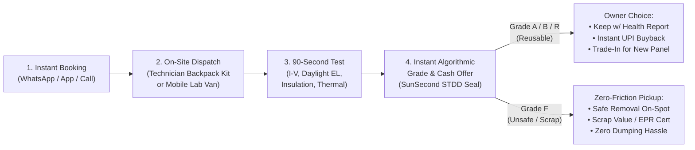
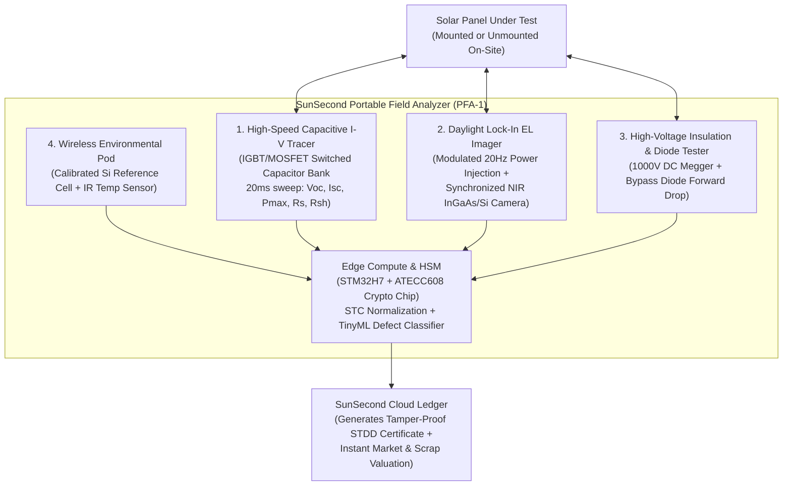
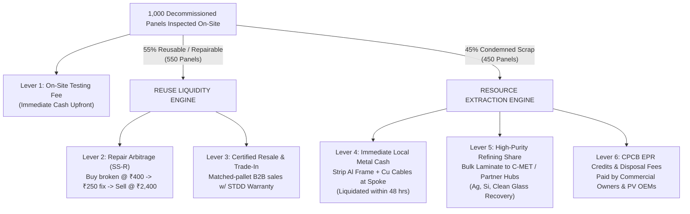
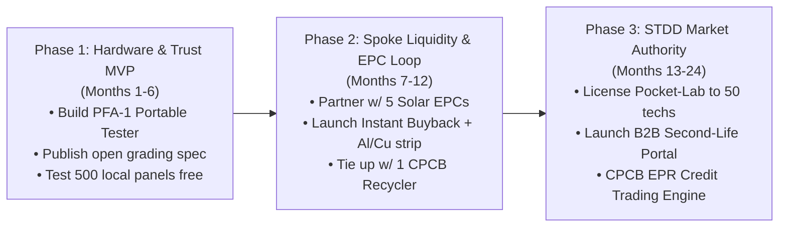

# SunSecond (STDD): The Gold-Standard Solar Lifecycle & Liquidity Platform
**Project: SunSecond** | **Subject: BEC754 — Start-up and Entrepreneurial Activity Assessment**  
**Department of Electronics Engineering, Rajkiya Engineering College, Sonbhadra**  
**Team**: Neeraj (`2308410300042`) & Pankaj (`2308410300044`)

---

## 1. Strategic Positioning: Becoming the "STDD" (Trust Standard)

To achieve a market position where **a "Pass" makes buyers purchase immediately without doubt** and **a "Fail" makes owners surrender the panel directly to SunSecond**, SunSecond must position itself like **GIA (for diamonds)** combined with **Cashify / Cars24 (for instant on-site valuation & liquidity)**.

### Solving the Core Trust Paradox
A major threat to any inspection-and-buyback company is **perceived conflict of interest**:
* *Seller fear*: "Are they failing my good panel just to take it as cheap scrap?"
* *Buyer fear*: "Are they passing a fire-hazard panel just to sell it at a high price?"

**The SunSecond Engineering Solution: Zero-Human-Bias Cryptographic Grading**
The human technician *never* decides the grade. The proprietary **SunSecond Field Analyzer (PFA-1)** directly signs raw electrical waveforms, thermal maps, and electroluminescence images with an onboard **Hardware Security Module (HSM)** and pushes them to the cloud.
1. **Owner gets an immutable live report** on their phone within 60 seconds showing exact STC-normalized Wattage, Insulation Safety (MΩ), and internal cell cracks.
2. **If Certified Reusable (`SS-A` / `SS-B`)**: Backed by a **SunSecond Performance & Safety Guarantee** (creating instant buyer confidence).
3. **If Condemned (`SS-F` - Unsafe/Dead)**: The system generates a legally valid **Electrical Safety Hazard Notice & CPCB Environmental Disposal Certificate**. Commercial owners (bound by fire insurance & CPCB EPR rules) and homeowners (fearing rooftop fire/electrocution) immediately surrender the panel to SunSecond for hassle-free removal.

---

## 2. The Seamless On-Site Experience (Hassle-Free UX)

Customers—whether a farmer with 10 panels, a homeowner with 8 panels, or a factory with 2,000 panels—interact with one frictionless workflow:

### Tiered On-Site Deployment (Solving Logistics Economics)
Testing 1 panel on a residential roof with a ₹25 Lakh van loses money. SunSecond uses a **two-tier hardware fleet**:
* **Tier 1 — SunSecond Pocket-Lab (Technician Backpack Kit)**: Deployed via trained partner technicians (like Urban Company) for residential roofs, farms, and small shops (1–30 panels). Dispatch cost: < ₹300.
* **Tier 2 — SunSecond Mobile Lab Van**: Automated conveyor/rack unit for commercial rooftops, warehouses, and utility solar parks (50–5,000+ panels/day).

---

## 3. Electronics Engineering Architecture: The On-Site Hardware Moat

Standard lab testing requires uninstalling panels and shipping them to a darkroom lab with a ₹30 Lakh Sun Simulator. **SunSecond's intellectual property is bringing lab-grade accuracy onto a sunny rooftop in under 90 seconds per panel.**

### Four Core Electronics Innovations
1. **20-Millisecond Capacitive Load I-V Sweeper**: Instead of bulky resistive load banks that overheat, an electronically switched pre-charged capacitor bank sweeps the panel from short-circuit (\(I_{sc}\)) to open-circuit (\(V_{oc}\)) in 20 ms while a 16-bit ADC captures 500 voltage-current pairs. Paired with a wireless calibrated reference cell, the firmware normalizes real-time output to Standard Test Conditions (\(1000\,\text{W/m}^2, 25^\circ\text{C}\)).
2. **Daylight Lock-In Electroluminescence (dEL)** *(Major EE Differentiator)*: Normally, EL imaging requires a pitch-black room because sunlight overwhelms the weak 1,150 nm infrared glow of silicon cells. By injecting a **modulated square-wave forward-bias current** (e.g., 10–30 Hz) into the panel and synchronizing the NIR camera shutter to take ON-frame minus OFF-frame differential exposures (digital lock-in amplification), **micro-cracks and dead cell fingers become visible in broad daylight**!
3. **Active Safety & Bypass Diode Diagnostics**: Automatically tests insulation resistance at 500V/1000V DC (IEC 61730 safety check) and injects reverse pulses to detect shorted or open bypass diodes inside the junction box—instantly identifying panels that can be revived with a ₹150 repair.
4. **Tamper-Proof Laser/NFC Passport**: Immediately pairs the physical panel serial number with a ruggedized QR/NFC sticker linked to the cryptographic test log.

---

## 4. The Official "SunSecond STDD" Grading System

| STDD Grade | Technical Criteria | Physical Action | Commercial Destination |
| :--- | :--- | :--- | :--- |
| **`SS-A+` (Prime Reuse)** | > 85% rated \(P_{max}\), Insulation > 40 MΩ·m², Zero severe EL cracks | Clean, apply NFC STDD Seal | Residential off-grid, commercial sheds, EV charging canopies (3-yr warranty) |
| **`SS-A` (Standard Reuse)** | 75%–85% \(P_{max}\), Safe insulation, Minor cosmetic yellowing | Clean, certify, bundle in voltage-matched pallets | Agricultural solar pumps, cold storage, telecom backup, rural microgrids |
| **`SS-R` (Repairable)** | Healthy cells (>75%), but failed bypass diode / burnt junction box / torn MC4 connector | Swap J-Box / add Smart Bypass Optimizer (₹250 cost) $\rightarrow$ Retest to `SS-A` | High-margin arbitrage! Bought at broken-panel price, sold at `SS-A` price |
| **`SS-B` (Low-Voltage Utility)** | 60%–75% \(P_{max}\), Safe insulation, localized cell damage | Derate wattage label strictly | Streetlights, fence energizers, battery trickle-chargers, village lighting |
| **`SS-F` (Condemned / Scrap)** | < 60% \(P_{max}\), Shattered glass, Insulation failure (< 40 MΩ·m²), Severe hotspots | **Red-Tagged Unsafe** $\rightarrow$ Immediate removal & Hub-and-Spoke extraction | Dismantling, raw material recovery, CPCB EPR credit generation |

---

## 5. Maximizing Cash Flow: The Dual-Liquidity Financial Engine

To extract **maximum liquid money** from both streams without getting trapped in slow inventory or CEEW's modelled recycling losses, SunSecond runs **6 synchronized revenue levers**:

### How SunSecond Overcomes CEEW's Negative Recycling Economics
CEEW's study showed standalone recycling loses ₹10,000–₹12,000/tonne when recyclers *pay for waste*, haul heavy intact panels long distances, and rely solely on commodity sales. SunSecond reverses every single cost driver:

1. **Zero / Negative Feedstock Cost on Scrap (`SS-F`)**: Because SunSecond diagnoses the panel as an *electrical/fire hazard* on-site, commercial clients (factories, malls, solar parks) happily surrender `SS-F` panels for **₹0 (free pickup)** or pay a **Safe Decommissioning & CPCB Compliance Fee (₹150–₹250/panel)** to eliminate legal liability.
2. **Spoke-Level Instant Metal Liquidity (48-Hour Cash Conversion)**: Never pay freight to ship bulky aluminum frames 500 km to a central refinery. At regional city spokes, semi-automated pneumatic frame pullers strip the **Aluminum frame (~2.2 kg)** and **Copper junction box/cables (~0.3 kg)** immediately:
   * Local Al scrap sale: ~₹380–₹420/panel (**instant cash in 24–48 hours**).
   * Local Cu cable sale: ~₹150–₹180/panel (**instant cash in 24–48 hours**).
   * *Result*: Stripping frames reduces transport volume by **65%** and generates **₹550+ of instant cash** before the silicon/glass laminate ever reaches the chemical/thermal refinery!
3. **High-Margin Repair Arbitrage (`SS-R`)**: Roughly 15–20% of "dead" panels only have a burnt ₹40 bypass diode or corroded MC4 connector. SunSecond's tester spots this in 10 seconds, buys the "dead" panel at ₹400–₹500, replaces the junction box for ₹250, certifies it as `SS-A`, and sells it for ₹2,200–₹2,600 (**>250% gross margin**).
4. **EPC Trade-In Velocity (Zero Customer Acquisition Cost)**: Partner with rooftop solar EPCs (Tata Power Solar, Loom Solar, local installers) who are upgrading old roofs. When an EPC replaces a customer's old system, SunSecond certifies and buys out the old panels instantly—giving the customer an instant discount on their new solar plant while feeding SunSecond a zero-CAC pipeline.
5. **High-Purity Laminate Processing (Asset-Light Hub Partnership)**: Instead of spending ₹5 Crore on chemical reactors on Day 1, aggregate dense, de-framed glass-silicon laminates in 20-ton lots and process via revenue-share/toll-processing agreements with **C-MET licensed facilities or CPCB-registered recyclers** (capturing Silver, Silicon, Clean Cullet, and **CPCB EPR Certificates**).

---

## 6. Blended Unit Economics Model (Per 1,000 Panels / ~20 Metric Tons)

Assuming a realistic commercial/repowering mix of 1,000 retired 300W panels (~20 kg each):
* **400 panels (`SS-A` / `SS-B`)**: Directly reusable.
* **150 panels (`SS-R`)**: Repairable (diode/J-box swap).
* **450 panels (`SS-F`)**: Condemned/shattered scrap.

| Line Item | Volume | Rate / Unit | Cash Flow (₹) | Liquidity Speed |
| :--- | :--- | :--- | :--- | :--- |
| **INFLOWS (REVENUE)** | | | | |
| 1. On-Site Testing & STDD Certification Fee | 1,000 panels | ₹150 / panel | +₹1,50,000 | Day 0 (Instant) |
| 2. Certified Second-Life Resale (`SS-A`/`SS-B`) | 400 panels | ₹2,400 / panel | +₹9,60,000 | 15–30 Days |
| 3. Repaired & Certified Resale (`SS-R` $\rightarrow$ `SS-A`) | 150 panels | ₹2,300 / panel | +₹3,45,000 | 15–30 Days |
| 4. Instant Spoke Scrap (Al Frame + Cu Cable on `SS-F`) | 450 panels | ₹550 / panel | +₹2,47,500 | 2–3 Days |
| 5. Laminate Extraction Value (Ag + Si + Clean Glass share) | 450 panels | ₹450 / panel | +₹2,02,500 | 30–45 Days |
| 6. CPCB EPR Certificate & Safe-Disposal Compliance Fee | 450 panels | ₹250 / panel | +₹1,12,500 | 30 Days |
| **TOTAL GROSS REVENUE** | **1,000 panels** | **₹2,017.5 avg** | **₹20,17,500** | |
| **OUTFLOWS (DIRECT COSTS)** | | | | |
| 1. Buyback Payout to Panel Owners (`SS-A`/`SS-B`) | 400 panels | ₹1,100 / panel | -₹4,40,000 | Day 0 |
| 2. Buyback Payout for Broken/Repairable (`SS-R`) | 150 panels | ₹450 / panel | -₹67,500 | Day 0 |
| 3. Buyback/Incentive for Scrap (`SS-F`) *(Most free/paid)* | 450 panels | ₹100 / panel avg | -₹45,000 | Day 0 |
| 4. Repair Parts (J-Box, Ideal Diodes, MC4, Sealant) | 150 panels | ₹250 / panel | -₹37,500 | Day 2 |
| 5. Spoke Dismantling, Logistics & Partner Refining Toll | 450 panels | ₹480 / panel | -₹2,16,000 | 15 Days |
| 6. Field Operations, Van Fuel, Warranty Reserve (5%) | 1,000 panels | ₹220 / panel | -₹2,20,000 | Monthly |
| **TOTAL DIRECT COSTS** | **1,000 panels** | **₹1,026 avg** | **-₹10,26,000** | |
| **NET CONTRIBUTION PROFIT (PER 1,000 PANELS)** | | **₹991.5 / panel** | **+₹9,91,500** | **~49.1% Blended Margin** |

> [!TIP]
> **The Strategic Takeaway**: Pure recycling alone operates on razor-thin or negative margins (as CEEW proved). By using **on-site electronics diagnostics** to cherry-pick the 55% reusable/repairable panels *before* crushing them, SunSecond subsidizes the entire logistics network and achieves a **~49% blended gross margin**—converting a waste liability into a high-liquidity cash machine.

---

## 7. Phased Roadmap to Build the "STDD" Brand (0–24 Months)

### Phase 1: Prove the Hardware (Coursework / Capstone Stage)
* Engineer the benchtop/portable **PFA-1 prototype** (Capacitive I-V tracer + Bypass diode tester + Modified NIR camera for lock-in EL + STM32 firmware).
* Publish the **SunSecond STDD Open Grading Specification** (transparent scoring thresholds for `SS-A+` through `SS-F`) to establish academic and industry authority.

### Phase 2: Asset-Light Cash Flow (First Commercial Pilot)
* Avoid heavy factory CAPEX. Operate as an **on-site diagnostic, trade-in, refurbishment, and spoke-dismantling company**.
* Partner with a CPCB-registered recycler (e.g., Regain Energies or a C-MET technology licensee) to handle Stage-5 chemical silver/silicon extraction on a tolling/revenue-share basis while SunSecond controls the customer relationship, data, grading standard, and high-margin second-life trade.

### Phase 3: Scaling the Standard & Franchise Network
* Rent/lease the **SunSecond Pocket-Lab** kit to certified local solar technicians across Tier-2/Tier-3 Indian cities on a per-certificate SaaS fee, turning SunSecond into the nationwide digital standard for every retired solar panel in India—and exporting the exact turnkey model to ASEAN, MENA, and Africa.
