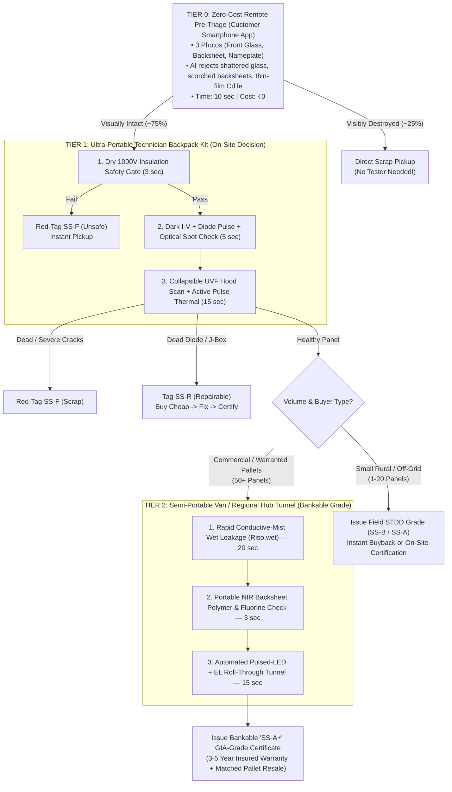
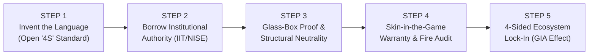

# Becoming the "GIA for Solar": Decision-First Triage Science & Trust Monopoly Playbook
**Project: SunSecond** | **Subject: BEC754 — Start-up and Entrepreneurial Activity Assessment**  
**Department of Electronics Engineering, Rajkiya Engineering College, Sonbhadra**  
**Team**: Neeraj (`2308410300042`) & Pankaj (`2308410300044`)

---

## 1. The Core Engineering Breakthrough: Decision Accuracy vs. Numeric Metrology

Traditional solar testing fails commercially for second-life panels because engineers copy factory **metrology** standards.

* **Factory Metrology (IEC 60904-9 Class AAA Sun Simulator)**: Designed to measure exact wattage to \(\pm 0.5\%\) (e.g., distinguishing \(301.2\text{ W}\) from \(302.4\text{ W}\)). It costs **₹50 Lakh–₹1 Crore**, requires a climate-controlled darkroom, and is far too slow and expensive for retired panels.
* **SunSecond Decision-First Triage**: For reuse vs. repair vs. scrap, **nobody cares whether a used panel outputs 238 W or 244 W**. What matters with **>98% classification accuracy** are four binary/banded decisions:
  1. **Will it electrocute someone or ignite a roof fire?** *(Safety Veto)*
  2. **Will its polymer/glass structure survive another 7–10 years?** *(Reliability & Aging)*
  3. **Is a dead panel actually just a ₹150 broken diode/connector?** *(Repair Arbitrage)*
  4. **Which output band does it belong to?** *(>80% Prime, 65–80% Utility, <65% Scrap)*

> [!IMPORTANT]
> **Critical Empirical Finding (CSIRO & IEA PVPS Task 13)**: Large-scale screening of thousands of retired panels proved that **14% to 15% of panels that pass BOTH I-V power testing AND Electroluminescence (EL) imaging still FAIL wet-leakage electrical safety tests**. Therefore, **Safety must be Gate 1**, never an afterthought.

---

## 2. Exhaustive Research: Fast, Non-Metrology Testing Methods & Tools

Below is an evaluation of every viable non-destructive evaluation (NDE) method from global PV research (NREL, Fraunhofer ISE, CSIRO, IEA PVPS Task 13), ranked for **decision accuracy, speed, weather independence, and hardware cost**.

| Method / Tool | What It Decides (Faults Caught) | Time / Panel | Needs Sun or Darkroom? | Hardware Cost (Approx.) | Portability | Decision Value |
| :--- | :--- | :--- | :--- | :--- | :--- | :--- |
| **1. Smartphone AI Visual Pre-Triage** | Shattered glass, severe burn marks, snail trails, nameplate OCR (CdTe vs. c-Si, banned BOMs) | 5 sec | Regular daylight | ₹0 (Phone App) | Ultra-Portable (Customer's phone) | Eliminates 25–30% obvious junk *before* technician dispatch |
| **2. Dry Hi-Pot / Megger Insulation (`Riso,dry`)** | Frame-to-circuit short, severe backsheet breach, shock hazard (IEC 61730) | 3 sec | Weather-independent | ₹15k–₹35k | Handheld / Pocket | Instant **Safety Veto** on-site |
| **3. Rapid Mist / Conductive-Foam Wet Leakage (`Riso,wet`)** | Micro-cracks in backsheet, hidden moisture ingress paths (catches the 14% missed by I-V/EL) | 15–25 sec | Weather-independent | ₹40k–₹80k | Semi-Portable (Van Tray / Spoke) | **Mandatory** for issuing certified resale warranties |
| **4. Dark I-V Curve + Bypass Diode Pulse** | Series resistance (\(R_s\): solder fatigue), shunt resistance (\(R_{sh}\): PID/cracks), dead bypass diodes, open cell strings | **2 sec** | **NO sunlight needed!** Works indoors/night/under tarp | ₹25k–₹60k (Custom MCU + MOSFET sweep) | Handheld / Backpack | **Core electrical engine** — zero irradiance noise! |
| **5. UV Fluorescence (UVF) Imaging** | **Hidden micro-cracks** (dark photobleached lines in glowing EVA), EVA acetic acid aging, delamination, past hotspots | **5 sec** | Needs shade/hood or dusk (NO electrical wiring!) | **₹5k–₹15k** (365 nm UV-A LEDs + phone/RGB cam) | Ultra-Portable (Pop-up shade hood) | **Secret Weapon**: Replaces ₹10L EL setups for field screening |
| **6. Active Pulse Thermography** | Live thermal hotspots, shunted cells, burnt solder ribbons, overheating junction boxes | 8–10 sec | **NO sunlight needed!** (Inject 3s current pulse) | ₹20k–₹45k (256×192 LWIR camera) | Handheld | Creates **visceral visual proof** that buyers/owners instantly trust |
| **7. Portable NIR Spectroscopy (900–1700 nm)** | Backsheet polymer ID (PET vs. PVDF vs. failure-prone Polyamide/AAA), chemical hydrolysis/embrittlement, fluorine check for recycling | 3 sec | Weather-independent | ₹1.5L–₹3L (e.g., TI DLP NIRscan Nano) | Handheld / Spoke | Predicts future backsheet failure **AND** pre-sorts toxic fluorinated scrap for recyclers |
| **8. Ambient / Reference-Cell Flash Estimate** | Approximate power band (detects optical browning/glass opacity missed by Dark I-V) | 5 sec | Sunlight OR simple LED flash bar | ₹15k–₹30k | Portable / Van | Closes the one blind spot of Dark I-V (optical transmission loss) |
| **9. Full Electroluminescence (EL) + Pulsed LED Tunnel** | Brand-new transport cracks (not yet bleached in UVF) + exact power matching (\(\pm 2\%\)) | 15 sec | Enclosed roll-through tunnel | ₹8L–₹18L | **Non-Portable / Van-Fixed** | Used **only** at Regional Hub / Mobile Van for Grade `SS-A+` commercial pallets |

---

### Why These Three Methods Form a "Miracle Stack" for Electronics Engineers

#### A. Dark I-V Curve Testing (No Sunlight, 2 Seconds, Zero Weather Noise)
Illuminated outdoor I-V curves suffer from passing clouds, dust, tilt error, and temperature drift. **Dark I-V treats the solar panel as a giant series matrix of diodes**:
* Inject a fast forward-bias DC ramp (up to \(I_{sc}\)) in dark or shaded conditions (a simple lightweight opaque blanket over the panel works on a sunny roof!).
* On a semi-log plot (\(\ln I\) vs. \(V\)), the curve directly isolates:
  * **Low-voltage region**: Shunt resistance (\(R_{sh}\)) $\rightarrow$ detects PID and internal cell shorts.
  * **Mid-voltage region**: Ideality factor (\(n\)) $\rightarrow$ detects semiconductor recombination damage.
  * **High-voltage region**: Series resistance (\(R_s\)) $\rightarrow$ detects corroded solder ribbons and cracked busbars.
* **Reverse/Step Pulse (0.5 sec)**: Instantly reveals if 1 of the 3 bypass diodes is shorted or open (marking the panel **`SS-R` — High-Profit Repairable**).

#### B. UV Fluorescence (UVF) Imaging — The ₹10,000 Alternative to Electroluminescence
Validated by **NREL** and **Fraunhofer ISE**:
* As EVA encapsulant ages outdoors, it forms fluorescent chemical byproducts.
* When illuminated by **365 nm UV-A LEDs** (using a cheap collapsible fabric pop-up light hood + standard RGB camera), aged EVA glows bright yellow-green.
* Wherever a silicon cell has a **micro-crack**, oxygen diffuses through the backsheet and **photobleaches** the EVA along the crack—making every crack appear as a **razor-sharp dark line**!
* **Huge Advantage**: Requires **zero electrical connections** and **zero expensive InGaAs IR sensors**. It simultaneously exposes cracks, EVA degradation, and moisture ingress in 5 seconds.

#### C. Rapid Wet-Leakage Safety Screening (Without a 10-Minute Bath)
Traditional IEC 61215 wet-leakage testing immerses a panel in a giant tank of surfactant water—impossible on a rooftop.
* **On-Site Field Proxy**: Dry 1000V DC Insulation test (`Riso,dry`) + Portable NIR/Visual backsheet crack scan (catches severe hazards immediately).
* **Spoke / Van Rapid Wet-Leakage**: Instead of full tank submersion, place the panel face-down onto a **conductive surfactant-wetted sponge/mist bed** connected to a 1000V Hi-Pot tester. Wet surface contact forms in **10 seconds**, validating \(R_{iso,wet} > 40\text{ M}\Omega\cdot\text{m}^2\) rapidly without water mess.

---

## 3. Optimal Hardware Architecture: What Should Be Portable vs. Non-Portable?

Trying to cram every lab test into a handheld box destroys reliability and inflates cost. Instead, deploy a **3-Tier Triage Funnel** where cheap, fast tests eliminate bad panels early so expensive tests only run on high-value panels.

### Why This Split Wins Economically & Technically
* **Tier 0 (Phone)** saves wasted technician travel on visibly broken glass.
* **Tier 1 (Backpack — ₹1.2 Lakh total BOM)** makes **95% of Reuse/Repair/Scrap decisions right on the customer's roof in <30 seconds**, day or night, rain or shine.
* **Tier 2 (Regional Hub / Van Tunnel — ₹12–18 Lakh)** only touches pre-qualified panels destined for high-margin warranted resale (`SS-A+`) or backsheet fluorine sorting (NIR) for recycling.

---

## 4. The Step-by-Step Playbook: Becoming the "One and Only GIA for Solar"

The **Gemological Institute of America (GIA)** didn't start as a monopoly. It became the world's unchallenged standard for diamonds by executing five deliberate moves. Here is the exact playbook adapted for **SunSecond**:

### Step 1 (Months 0–3): Invent and Give Away the Industry Language
* **GIA's Move**: GIA invented the **4Cs** (Cut, Color, Clarity, Carat) and gave the terminology to jewelers and consumers for free. Once customers ask for a "VVS1, D-Color" diamond, only GIA's standard matters.
* **SunSecond's Move**: Publish an open, dead-simple **SunSecond "4S" Grading Language** that even a rural farmer or factory owner understands in 10 seconds:
  1. **S1 — Safety** (`PASS` / `HAZARD`): Insulation & fire risk.
  2. **S2 — Structure** (`INTACT` / `STRESSED` / `CRACKED`): UVF crack map & backsheet polymer state.
  3. **S3 — Silicon Health** (`STRONG` / `REPAIRABLE` / `DEGRADED`): Dark I-V resistance & diode health.
  4. **S4 — Service Band** (`BAND-85`, `BAND-75`, `BAND-60`, `SCRAP`): Guaranteed usable output tier.
* **Goal**: Make buyers across India stop asking *"How old is this panel?"* and start asking *"Does it have a SunSecond 4S QR?"*

### Step 2 (Months 3–9): Borrow Institutional Trust (Do Not Ask People to Trust a Startup)
* **The Reality**: Nobody trusts a 6-month-old startup's stamp on Day 1.
* **SunSecond's Move**: Take 200 retired panels of varying ages and run a **blind correlation study** comparing SunSecond's 30-second triage kit against a government/NABL-accredited reference lab (**IIT Bombay NCPRE**, **NISE Gurugram**, or **C-MET Hyderabad**).
* **The Credibility Weapon**: Print a single validated metric on every SunSecond report and website:
  > *"Validated against NABL-accredited IEC 61215/61730 laboratory protocols: **98.2% Safety & Grade Decision Accuracy**."*
* Invite **MNRE / BIS (Bureau of Indian Standards)** committee members to review your open grading standard—positioning SunSecond to help write India's eventual formal second-life PV standard!

### Step 3 (Months 9–14): "Glass-Box" Visual Proof & Neutralizing Conflict of Interest
* **Why People Distrust Middlemen**: If a buyer says "your panel is junk, give it to me for ₹100," the owner suspects a scam.
* **SunSecond's Dual Trust Mechanism**:
  1. **Visceral Visual Evidence**: Don't just show numbers (`Rsh = 12 Ω`). Show the owner the **live Active Thermal photo** (a bright glowing 130°C hotspot on their panel) and the **UVF image** (spiderwebs of dark cracks) right on their WhatsApp within 60 seconds, signed cryptographically by the test device. People believe their own eyes instantly.
  2. **The "Free-to-Walk" Independence Rule**: Operate **SunSecond Certify** with transparent, non-coercive choice. When a panel gets an `SS-A` certificate, the owner is 100% free to keep it or sell it to *anyone else* using your QR certificate. Paradoxically, **giving owners complete freedom to walk away proves your grading is honest**—causing >80% of them to accept SunSecond's instant one-click UPI buyback anyway!

### Step 4 (Months 14–20): Risk Inversion (Making Both "Keep" and "Throw" Effortless)
To fulfill your exact vision—*public happily buys if we pass, owners happily surrender if we fail*—engineer asymmetric incentives on both sides:
* **Why Buyers Trust a `PASS` Instantly**:
  * Every `SS-A` / `SS-A+` panel carries a **SunSecond Performance & Replacement Warranty** (backed by a 4–5% warranty reserve fund or micro-insurer). If a certified panel fails within 2–3 years, SunSecond swaps it free. Zero risk for the buyer!
* **Why Owners Throw `FAIL` Panels Directly to SunSecond**:
  * For **Commercial / Industrial Roofs**: Issue a formal **SunSecond Fire-Safety Condemnation & CPCB EPR Handover Manifest**. Keeping a condemned panel risks voided fire insurance and CPCB legal penalties; handing it to SunSecond eliminates all legal liability in one signature.
  * For **Homeowners / Farmers**: Offer **Zero-Hassle De-Installation + Instant Trade-In Credit** (₹300–₹500 voucher toward a certified `SS-A` replacement or new partner EPC panel). They never have to pay labor to take dead glass off their roof or find a scrap dealer.

### Step 5 (Months 20–36): The Four-Sided Lock-In (Becoming the *Only* Standard)
A certification becomes an unbreakable monopoly when **third-party financial and regulatory gatekeepers mandate it**:

| Gatekeeper | Why They Adopt SunSecond STDD | How It Locks In Your Monopoly |
| :--- | :--- | :--- |
| **1. General & Fire Insurers** | Faulty solar panels are a top emerging cause of warehouse/factory roof fires. | Insurers require a **SunSecond Safety Certificate** before insuring any commercial roof with >5-year-old or reused panels. |
| **2. Rural Banks / NBFCs / NABARD** | Banks refuse to finance used solar pumps because they cannot verify collateral value. | Banks approve micro-loans **only for SunSecond STDD-certified panels**, instantly making uncertified grey-market panels unsellable. |
| **3. Solar EPCs & O&M Firms** | EPCs want to sell new 600W panels to old customers but don't want to manage old-panel headaches. | EPCs embed SunSecond's technician kit/API into every repowering contract as the official trade-in & disposal partner. |
| **4. CPCB & Registered Recyclers** | Recyclers bleed money sorting unknown mixed scrap and proving EPR compliance. | Recyclers pay a premium for SunSecond's pre-sorted, NIR-verified, de-framed scrap batches with ready-made CPCB digital manifests. |

---

## 5. Coursework Action Summary: Your First 90-Day Engineering Prototype

To prove this entire vision in an Electronics Engineering capstone or pitch competition without spending lakhs:
1. **Build the ₹18,000 Proof-of-Concept Triage Kit**:
   * **Dark I-V + Diode Sweeper**: STM32 / ESP32 + constant-current MOSFET driver + INA226 voltage/current ADC (~₹4,500).
   * **UV Fluorescence Rig**: 365 nm UV-A LED strip (high-power) + collapsible black cloth box + smartphone camera with yellow long-pass filter (~₹3,500).
   * **Thermal Hotspot Check**: Entry-level USB-C thermal module (e.g., Topdon TC001 / InfiRay P2 Pro) plugged into the same tablet/phone (~₹10,000, or borrowed from college lab).
   * **Safety Gate**: Standard 1000V Digital Insulation Tester / Megger (already available in every college Electrical Machines Lab!).
2. **Test 15–20 Old/Damaged Panels Locally**: Source rejected panels from local solar installers or college rooftops.
3. **Generate Live "SunSecond 4S" Reports**: Show your professors side-by-side **Dark I-V curves + UVF crack photos + Active Thermal hotspots** proving you can accurately separate **Safe Reuse**, **₹150 Diode Repair**, and **Dangerous Scrap** in **under 45 seconds** without a ₹50 Lakh solar simulator.
