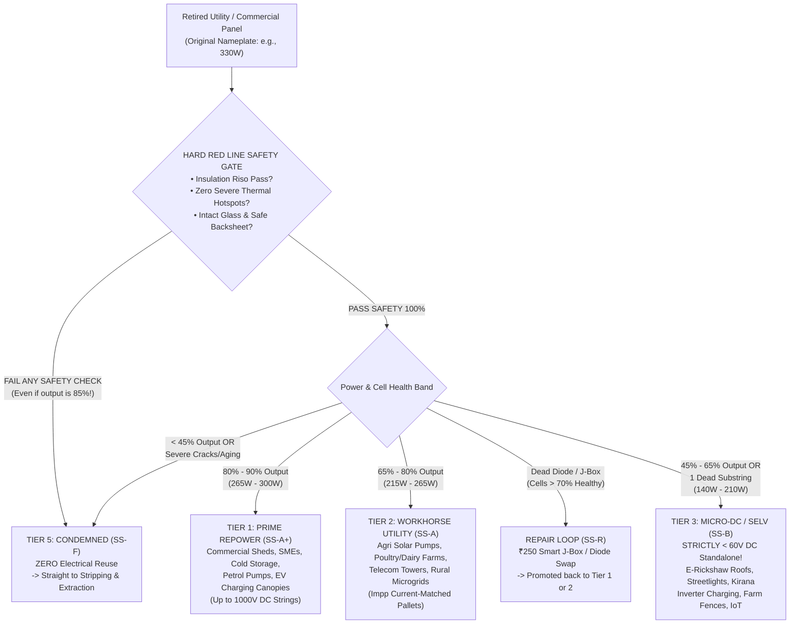
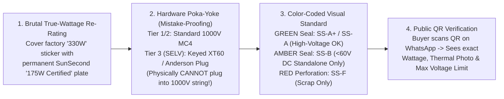

# SunSecond Cascade Reuse Architecture & Field Interview Kit
**Project: SunSecond** | **Subject: BEC754 — Start-up and Entrepreneurial Activity Assessment**  
**Department of Electronics Engineering, Rajkiya Engineering College, Sonbhadra**  
**Team**: Neeraj (`2308410300042`) & Pankaj (`2308410300044`)

---

## 1. The Core Philosophy: How GIA Grades Lower Tiers Without Losing Trust

A common fear is: *"If SunSecond sells degraded, lower-output solar panels (e.g., 50%–65% output), won't that ruin our premium GIA-level reputation?"*

**The exact opposite is true.** Look at the **Gemological Institute of America (GIA)**:
* GIA does **not** only grade flawless, million-dollar D-color diamonds. GIA grades heavily included, low-color J–Z industrial/budget stones too.
* **Why does GIA never lose trust?** Because **GIA never lies about what a stone is.** A buyer who pays for a budget grade gets *exact, brutal honesty*—and knows it will never be falsely passed off as flawless.

For **SunSecond (STDD)**, the golden rule is:
> **Degraded power is acceptable—if honestly re-rated, safely matched, and routed to the right voltage application. Compromised electrical safety is NEVER acceptable.**

---

## 2. The SunSecond Cascade Reuse Ladder (Extracting Every Meaningful Watt)

In a utility solar farm, land, mounting steel, and inverters are expensive—so dropping from 330 W to 240 W (or 160 W) makes a panel "economically dead" to the big farm. However, for a rural farm, a shop roof, a poultry shed, or a streetlight where space is abundant and grid electricity is expensive or unreliable, **that same panel is still a goldmine for another 8–12 years.**

---

## 3. Deep Technical & Commercial Breakdown of Every Reuse Tier

### Tier 1: Prime Repowered (`SS-A+` | 80%–90% Original Power)
* **Source**: Early utility repowering (10–12 year old panels replaced to install 600W bifacials), insurance write-offs (hailstorm at one corner of a farm where 60% of panels were untouched), or factory excess stock.
* **Target Buyers (India & Global)**: Small & Medium Enterprises (SMEs), textile/packaging workshops, cold storage units, dairy chilling centers, commercial parking canopies.
* **Why They Buy**: Commercial grid tariffs in India are **₹9–₹14/kWh**. Buying `SS-A+` panels at **50% off new panel cost** delivers a **< 1.8-year payback period** for small factories that have large tin-shed roofs!
* **Engineering Safeguard**: Passes full `Riso,wet` wet-leakage test + UVF/EL inspection. Safe for standard 600V–1000V grid-tie inverters.

### Tier 2: Workhorse Utility (`SS-A` | 65%–80% Original Power)
* **Source**: 12–16 year old commercial/utility modules showing uniform EVA yellowing or moderate series resistance (\(R_s\)) rise, but zero dangerous hotspots.
* **Target Buyers**:
  * **Agricultural Solar Pumping** (farmers without PM-KUSUM subsidy slots who otherwise burn expensive diesel).
  * **Rural Microgrids & Mini-Grids** (Uttar Pradesh, Bihar, Jharkhand, Odisha, Sub-Saharan Africa).
  * **Poultry Farms, Brick Kilns, Flour Mills (*Atta Chakki*)**.
* **Critical Electronics Engineering Trick — Current Binning (\(I_{mpp}\) Matching)**:
  * *Problem*: Mixing a 7.2 A aged panel and an 8.5 A aged panel in series destroys string output.
  * *SunSecond Solution*: Our sorting software automatically groups Tier 2 panels into **narrow 0.25 A current bins** (e.g., *Pallet #42: All panels strictly 6.8 A–7.05 A*) so buyers get maximum string efficiency with zero mismatch loss!

### Tier 3: De-Rated Extra-Low-Voltage Micro-Power (`SS-B` | 45%–65% Output OR 1 Dead Substring)
* **This directly answers your question: *"What if a panel is slightly corrupted / generates much less, can we still extract meaningful electricity before scrapping?"***
* **The Physics Problem**: Suppose a 72-cell (330W) panel has 3 internal cell substrings (24 cells each). One substring has a cracked cell/broken ribbon, leaving 2 perfectly healthy substrings capable of generating **160W–190W at 24V DC** for another 8 years! If you put this panel in a 1000V string, it creates dangerous reverse bias and kills the whole string.
* **The Electronics Engineering Solution — SELV (< 60V DC) Isolation**:
  * Permanently bypass/isolate the dead substring inside the junction box (or install a ₹150 active diode bridge) and **re-rate the panel strictly for standalone Extra-Low Voltage (< 60V DC / SELV)**.
  * Below 60V DC, **human electrocution risk is practically zero** and **high-voltage DC arc fires cannot sustain themselves**.
* **Massive Indian & Global Micro-Use Cases for Tier 3 (`SS-B`)**:
  1. **Kirana Shops & Rural Homes (12V/24V Battery Inverter Charging)**: Millions of Indian homes already own a 12V lead-acid inverter battery. One ₹1,100–₹1,400 certified `SS-B` 170W panel + a ₹600 PWM controller cuts their electricity bill and provides daytime backup during power cuts!
  2. **E-Rickshaw Charging Sheds & Roof Toppers**: India has 2+ million e-rickshaws running on 48V batteries. Two `SS-B` panels (₹2,500 total) trickle-charge an e-rickshaw passively while parked between rides, adding 15–20 km of free daily range.
  3. **Solar Agricultural Fence Energizers (Jhatka Machines)**: Massive rural Indian demand to protect crops from wild boars/nilgai; needs only 40W–100W at 12V DC.
  4. **Solar Streetlights, Village Water-Tank Pumps, Aquaculture Pond Aerators, Telecom/CCTV/IoT Nodes**.

### Tier 4: Non-Electrical Architectural Reuse vs. Cell Salvage (Reality Check)
* **Can we cut out individual good silicon cells from a 30% shattered panel?**
  * **No.** Because EVA encapsulant is thermoset cross-linked, mechanically cutting individual silicon wafers out of a laminated sandwich shatters >70% of cells and costs more in labor than buying brand-new Grade-B solar cells (which cost <₹18/cell).
* **Hard Cutoff**: Below **45% output**, or if **any safety/structural red line is breached**, **do not try to force electrical reuse**. Immediately route to **Tier 5 (`SS-F` — Material Extraction)** where Aluminum, Copper, Silver, Silicon, and Glass yield higher, cleaner, and risk-free liquidity.

---

## 4. Engineering the "GIA Trust Firewall" (Protecting Brand Integrity Across Tiers)

How do you sell both a **₹2,800 Commercial Panel (`SS-A+`)** and a **₹1,100 Rural Micro-DC Panel (`SS-B`)** without a dishonest middleman ripping off a buyer or causing a roof fire that destroys SunSecond's name?

### The Four Anti-Fraud Hardware Controls
1. **True-Wattage Over-Labeling**: Never sell a degraded 330W panel as a "Used 330W Panel." Permanently bond an anodized/tamper-evident SunSecond nameplate over the factory label declaring its **new true wattage** (e.g., `SunSecond Certified: 175W ±5% | Max 60V DC`). If someone tries to peel it off, it leaves a `VOID` tamper pattern.
2. **Physical Connector Keying (Poka-Yoke)**: On Tier 3 (`SS-B`) panels, remove the standard 1000V MC4 connectors and crimp on **60V DC Anderson Powerpole / XT60 / Ring-Lug battery connectors**. This makes it **physically impossible** for an unscrupulous installer to plug a degraded Tier 3 panel into a high-voltage commercial rooftop inverter!
3. **Physical Condemnation for `SS-F` (Scrap)**: When a panel fails safety (`SS-F`), the technician **cuts off the MC4 connectors at the junction box on-site** and slaps on a bright red `CONDEMNED — ELECTRICAL HAZARD` seal so it can never secretly re-enter the grey market.
4. **Tier-Matched Warranties**:
   * `SS-A+`: 3–5 Year Replacement Warranty (Commercial bankable).
   * `SS-A`: 2 Year Replacement Warranty (Agri/SME).
   * `SS-B`: 6–12 Month Functional Guarantee (Micro-DC).

---

## 5. Field Customer-Discovery Interview Toolkit (For Your Coursework)

To validate **which reuse tiers have the highest real-world demand, pricing power, and trust barriers**, conduct **20–30 structured field interviews** across these 5 stakeholder segments in India (standard Lean Startup / academic entrepreneurship methodology).

> [!TIP]
> **The Mom Test Rule for Interviews**: Never pitch SunSecond first and ask *"Would you buy this?"* (people will politely say yes). Instead, ask about their **past behavior, current electricity/scrap costs, and actual horror stories**.

### Segment 1: Big Solar Farms / Commercial Plant O&M Managers & EPCs *(Supply Side)*
* **Who to interview**: Local solar EPC installers, factory facility managers with 5–10 year old roofs, O&M engineers.
* **Core Questions**:
  1. *"In the last 2 years, what happened to panels that cracked, failed, or were replaced during plant upgrades? Where are they sitting right now?"*
  2. *"How do you currently decide whether a low-performing panel on a site should be repaired, kept, or thrown away?"*
  3. *"Are you aware of CPCB's solar e-waste/EPR rules? How are you currently documenting disposal to avoid compliance issues or fire insurance risk?"*
  4. *"If a technician came on-site, tested every retired panel in 60 seconds, paid you instant cash for usable ones, and gave you a legal CPCB disposal certificate while hauling away the dead ones for free—what would stop you from saying yes?"*

### Segment 2: Small Firms / SMEs / Cold Storage / Poultry & Dairy Farms *(Tier 1 & 2 Buyers)*
* **Who to interview**: Owners of small manufacturing sheds, cold storages, petrol pumps, dairy chillers, or poultry farms paying commercial tariffs (₹9–₹13/unit).
* **Core Questions**:
  1. *"What is your monthly electricity or diesel generator bill right now, and why haven't you covered 100% of your shed roof with new solar panels yet?"*
  2. *"Have you ever considered buying used solar panels? If not, what specifically scares you about them (hidden damage, fire risk, fake wattage, no warranty)?"*
  3. *"If you had excess shed roof space, would you prefer paying ₹4 Lakh for brand-new 10 kW solar, or ₹2 Lakh for 10 kW of SunSecond-certified 2nd-life panels (occupying 25% more roof area) backed by a 3-year replacement warranty and an IIT/NABL-validated test report?"*

### Segment 3: Farmers, E-Rickshaw Owners & Kirana Shopkeepers *(Tier 2 & 3 Micro-DC Buyers)*
* **Who to interview**: Local farmers using diesel pumps/fences, e-rickshaw charging yard operators, rural shopkeepers with inverter batteries.
* **Core Questions**:
  1. *"How much do you spend every month on diesel for irrigation / grid power for charging your e-rickshaw or shop inverter?"*
  2. *"If you could buy a guaranteed, safe 160W–180W solar panel for ₹1,200–₹1,500 (instead of ₹4,500 new) that plugs straight into your 12V/24V/48V battery—what proof would you need to trust that it won't die next month?"*
  3. *"Would scanning a QR code on WhatsApp showing a green 'PASS' badge + live test wattage + 1-year free swap from a local shop convince you to buy it?"*

### Segment 4: Local Solar Technicians & Electricians *(The Distribution & Testing Force)*
* **Who to interview**: Independent solar installers and local electrical contractors.
* **Core Questions**:
  1. *"When a customer complains their solar system is generating less power, what tools do you currently use to find which exact panel is bad?"*
  2. *"How often do you find a panel that is totally dead only because of a burnt junction box or bypass diode?"*
  3. *"If SunSecond gave you a portable testing kit and paid you ₹150–₹250 per certified inspection plus a commission on every old panel bought back or sold—would you join as a certified partner?"*

### Segment 5: Scrap Dealers (*Kabadiwalas*) & Registered Recyclers *(Tier 5 / Extraction Channel)*
* **Who to interview**: Local aluminum/e-waste scrap aggregators and a CPCB-registered e-waste recycler.
* **Core Questions**:
  1. *"How much do you currently pay for a broken 20 kg solar panel, and what parts do you actually recover vs. dump?"*
  2. *"What is your biggest cost or headache when handling solar panels (transportation bulk, frame removal, glass shattering, lack of CPCB paperwork)?"*
  3. *"If we delivered pre-stripped, clean glass-silicon laminates sorted by backsheet type (fluorinated vs. non-fluorinated) in bulk truckloads with full weight manifests, how much more per kg would you pay?"*

---

## 6. Interview Scoring Matrix (How to Present Results in Your Coursework)

Track every interview in a structured validation table to prove **empirical product-market fit** to your professors:

| Reuse Tier | Target Segment | Validated Price Willingness (₹/W) | #1 Trust Trigger Found in Interviews | Primary Adoption Friction | Go / No-Go Verdict |
| :--- | :--- | :--- | :--- | :--- | :--- |
| **Tier 1 (`SS-A+`)** | SMEs / Factories | Target: ₹10–₹13 / W | 3-Year Swap Warranty + Fire Safety Cert | Extra roof area needed (+15–20%) | *Validate via 5+ SME interviews* |
| **Tier 2 (`SS-A`)** | Agri Pumps / Microgrids | Target: ₹8–₹10 / W | Current-matched pallets + Bank/NBFC acceptance | Rural transport logistics | *Validate via 5+ Farmer/EPC interviews* |
| **Tier 3 (`SS-B`)** | Kirana / E-Rickshaw / Fences | Target: ₹6–₹8 / W | Plug-and-play <60V safety + Local shop swap | Awareness of battery compatibility | *Validate via 10+ Rural/EV interviews* |
| **Tier 5 (`SS-F`)** | Commercial Owners / Recyclers | Disposal Fee / ₹0 intake + Al/Cu/Ag value | Legal CPCB EPR certificate + Free removal | Minimum batch pickup economics | *Validate via 5+ O&M/Recycler interviews* |
