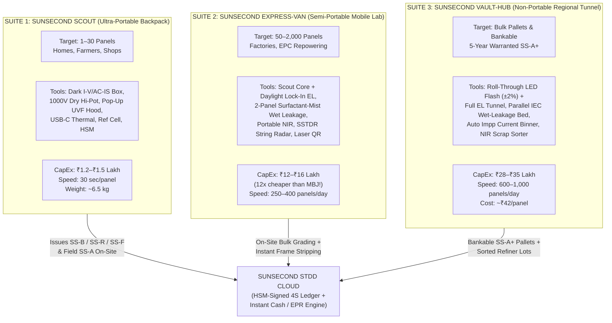
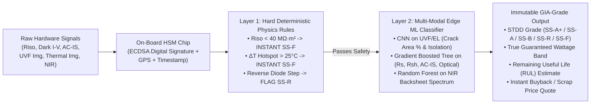

# SunSecond Testing Suites & Advanced Diagnostic Technology Architecture
**Project: SunSecond** | **Subject: BEC754 — Start-up and Entrepreneurial Activity Assessment**  
**Department of Electronics Engineering, Rajkiya Engineering College, Sonbhadra**  
**Team**: Neeraj (`2308410300042`) & Pankaj (`2308410300044`)

---

## 1. The Industry Reality Check: Why Existing Commercial Suites Cannot Build a GIA for Solar

Existing solar testing tools fall into two broken extremes—neither of which works for high-volume second-life qualification and recycling triage in India or globally:

| Existing Benchmark | Example Equipment | CapEx (Approx.) | Speed / Throughput | Cost per Panel Tested | Why It Fails SunSecond's Mission |
| :--- | :--- | :--- | :--- | :--- | :--- |
| **Fixed Accredited Lab** | IEC 17025 / Class AAA Sun Simulator | ₹8–₹12 Crore (\$1M+) | Days (shipping + queue) | ₹5,000–₹15,000 | Built for \(\pm 0.5\%\) factory metrology; unviable for ₹2,000 used panels. |
| **Commercial Mobile Lab** | MBJ Mobile Lab 5.0 (A+A+A+ LED + EL Van) | **₹1.8–₹2.3 Crore** (€200k–€250k) | 60–100 panels/day | ₹1,500–₹2,500 | Still chases factory numeric precision; CapEx kills unit economics. |
| **Handheld Field I-V Tracer** | Solmetric PVA / Seaward / HT Italia | ₹4–₹8 Lakh | 100–150 panels/day | ₹150–₹300 | **Weather-dependent** (clouds ruin accuracy); blind to micro-cracks, backsheet decay, and the 14% wet-leakage safety trap. |
| **SunSecond Decision Suites** | **Scout (Backpack) + Express-Van + Vault-Hub** | **₹1.2L to ₹30L** | **100 to 1,000 panels/day** | **₹42–₹85 / panel** | **Trades \(\pm 0.5\%\) wattage metrology for >98% Safety, Reliability & Power-Band Decision Accuracy in any weather.** |

---

## 2. Encyclopedia of 11 Advanced Non-Destructive Testing (NDE) Methods

To achieve **GIA-level decision accuracy without slow metrology**, SunSecond fuses **four physical sensing domains**—choosing fast, low-cost methods whose strengths cancel out each other's blind spots.

### Domain A: Electrical Safety & Dielectric Integrity *(The Non-Negotiable Veto)*
1. **Dry High-Voltage Insulation (`Riso,dry`) & Ground Continuity (IEC 61730)**
   * *How*: Applies 500V–1000V DC between shorted PV leads and aluminum frame for 3 seconds.
   * *Decision Value*: Instant field veto for gross shorts, punctured backsheets, or frame faults.
2. **Rapid Conductive-Mist / Sponge Wet-Leakage (`Riso,wet`, IEC 61215 MQT 15 Proxy)**
   * *Why Critical*: CSIRO & IEA PVPS Task 13 proved **14%–15% of panels that pass dry insulation, I-V, AND EL still fail wet-leakage safety** ("Dry Pass / Wet Fail").
   * *Innovation*: Traditional wet-leakage uses a slow, messy 10-minute water immersion tank. SunSecond replaces the bath with a **conductive surfactant-wetted foam/mist pressure bed** that bridges micro-cracks across the backsheet/edges in **15–20 seconds**, measuring true resistive leakage (\(> 40\text{ M}\Omega\cdot\text{m}^2\)) after filtering out initial capacitive charging transients.
3. **High-Frequency Capacitive Transient & Partial Discharge (PD) Screening** *(Advanced EE)*
   * *How*: Analyzes micro-discharge spikes and dielectric relaxation curves during the 1000V DC ramp.
   * *Decision Value*: Detects internal EVA delamination voids and creeping tracking paths before catastrophic ground faults occur in high-voltage strings.

### Domain B: Weather-Independent Electrical & Circuit Fingerprinting
4. **Dark I-V Curve Sweeping + Active Bypass Diode Pulse**
   * *How*: Treats the solar module as a giant series diode matrix in darkness/shade (using an opaque thermal blanket on a sunny roof or inside a van). A MOSFET constant-current circuit sweeps from \(0\) to \(I_{sc}\) in **2 seconds**—completely immune to clouds, tilt, and irradiance noise.
   * *Decision Value*: Extracts Series Resistance (\(R_s\) $\rightarrow$ solder corrosion/ribbon breaks), Shunt Resistance (\(R_{sh}\) $\rightarrow$ PID/cell micro-shorts), ideality factor (\(n\)), and instantly flags **dead bypass diodes (`SS-R` high-profit repairable)** via a 0.5-second reverse/step pulse.
5. **AC Impedance Spectroscopy (AC-IS / EIS) on PV Modules** *(Cutting-Edge EE)*
   * *How*: Superimposes a tiny multi-frequency AC sine wave (10 Hz–100 kHz) over the DC bias at the module terminals and computes the complex impedance Nyquist plot (\(Z(\omega) = R + jX\)) on an STM32 DSP.
   * *Decision Value*: **Moisture ingress** alters internal dielectric capacitance loops, while **early solder-joint intermetallic corrosion** shifts high-frequency resistance arcs—catching hidden degradation months before DC power drops!
6. **Spread-Spectrum Time-Domain Reflectometry (SSTDR)** *(Live-Array Radar)*
   * *How*: Injects a low-amplitude pseudo-noise RF code directly into **live, energized 1000V rooftop strings** without shutting down the solar plant. Reflections from impedance discontinuities pinpoint exact fault distance via time-of-flight correlation.
   * *Decision Value*: Lets SunSecond scan a 20-panel rooftop string in **10 seconds from the inverter box** to identify *which exact panels* have corroded connectors, arc faults, or cracked ribbons before touching a wrench.
7. **2-Second Optical Transmission / Mini-Flash Spot Check**
   * *Why Needed*: Dark I-V is blind to optical degradation (yellowed/browned EVA or cloudy anti-reflective glass coating).
   * *How*: A quick ambient reference-photodiode ratio check (or a cheap 50 ms calibrated LED flash bar inside a shade hood) estimates optical transmittance loss within \(\pm 4\%\)—plenty accurate for power-band sorting!

### Domain C: Optical & Thermal Structural Imaging *(The Visual Trust Proof)*
8. **UV Fluorescence (UVF) Imaging (365 nm UV-A)** *(The ₹10,000 EL-Killer)*
   * *Physics (NREL / Fraunhofer Validated)*: Field-aged EVA glows bright yellow-green under 365 nm UV-A light. Wherever a silicon cell has a **micro-crack**, oxygen diffuses through the backsheet and **photobleaches** the EVA—rendering every crack as a **razor-sharp dark line**.
   * *Decision Value*: Requires **zero electrical wiring** and uses a standard RGB camera + ₹3,500 UV-A LED strip inside a collapsible pop-up hood. Exposes micro-cracks, EVA acetic acid breakdown, delamination, and past hotspots in **5 seconds**.
9. **Active Pulse Thermography (Weather-Independent IR)**
   * *How*: Injects a safe 3-second forward/reverse DC current pulse into the module while recording with an entry-level LWIR microbolometer (256×192, e.g., InfiRay / FLIR Lepton).
   * *Decision Value*: Shunted cells, broken solder joints, and failing junction boxes light up bright red **indoors, at night, or in rain**. Visually showing an owner a glowing 130°C hotspot on WhatsApp creates **instant, zero-argument trust** to condemn (`SS-F`) unsafe panels.
10. **Daylight Lock-In Photoluminescence (dPL) & Daylight EL** *(UNSW / NREL Frontier)*
    * *How*: Modulates panel electrical state (via inverter switching or portable 20 Hz current driver) while a synchronized NIR camera subtracts OFF-frames from ON-frames to mathematically cancel out 100,000 lux of midday sunlight!
    * *Decision Value*: Enables **contactless drone or handheld high-resolution crack mapping in broad daylight** for massive utility solar farms (catching brand-new transport cracks that haven't photobleached in UVF yet).

### Domain D: Polymer Chemistry & Recycling Pre-Sorting *(Bridging Reuse & Scrap)*
11. **Portable Near-Infrared (NIR) Backsheet Spectroscopy (900–1700 nm) + Acoustic Tap**
    * *How*: A 3-second handheld touch sensor (e.g., Texas Instruments DLP NIRscan Nano + PCA/Random Forest ML model) reads molecular absorption bonds of the polymer backsheet.
    * *Decision Value (Dual-Purpose Genius)*:
      * **For Reuse**: Instantly spots chemically hydrolyzed PET or notorious cracking **Polyamide (AAA)** backsheets—preventing warranty disasters 2 years later.
      * **For Recycling**: Automatically separates **Fluorinated (PVDF/Tedlar — emits toxic HF gas if heated)** from **Non-Fluorinated (PET)** scrap, raising scrap resale value with CPCB/C-MET refiners!

---

## 3. Sensor Fusion: How Cheap Fast Methods Cancel Out Each Other's Blind Spots

No single cheap test is perfect. **GIA-level decision accuracy (>98%) comes from pairing complementary physics** so no fatal defect can ever slip through:

| Potential Hidden Defect | Dry Hi-Pot | Dark I-V + AC-IS | UVF (365 nm) | Active Thermal | Mist Wet-Leakage | Portable NIR | **Combined Decision Certainty** |
| :--- | :---: | :---: | :---: | :---: | :---: | :---: | :---: |
| **Electrocution / Moisture Path** | ⚠️ Misses 14% | 🟡 Partial (Cap shift) | 🟡 Edge delam | ❌ | ✅ **100% Catch** | 🟡 Backsheet cracks | **99.5% (Hard Veto)** |
| **Fire Risk / Shunted Hotspot** | ❌ | ✅ Shunt drop (\(R_{sh}\)) | 🟡 Past burns | ✅ **Direct Thermal** | ❌ | ❌ | **99.5% (Hard Veto)** |
| **Dead Bypass Diode (`SS-R`)** | ❌ | ✅ **Exact Substring** | ❌ | ✅ Hot J-Box | ❌ | ❌ | **99.9% (High Profit)** |
| **Aged Cell Micro-Cracks** | ❌ | 🟡 Severe only | ✅ **Razor Sharp** | 🟡 Active only | ❌ | ❌ | **98.5%** |
| **Fresh Transport Cracks (<3 mo)** | ❌ | ✅ \(R_s\) jump | ❌ *(Unbleached)* | ✅ Hotspot | ❌ | ❌ | **95% (99.5% w/ Hub EL)** |
| **EVA Browning / Glass Opacity** | ❌ | ❌ *(Blind)* | ✅ **Fluorescence hue** | ❌ | ❌ | ✅ Optical check | **96%** |
| **Brittle Backsheet / Fluorine ID** | ❌ | ❌ | 🟡 Chalking | ❌ | 🟡 If cracked | ✅ **97%+ Chem ID** | **97%** |

---

## 4. The Three SunSecond Testing Suites (Portable vs. Mobile vs. Fixed Hub)

Rather than forcing one heavy, expensive machine to do everything, SunSecond deploys **three synchronized hardware suites** sharing one unified cryptographic cloud ledger.

### Detailed Suite Architecture & Economics

#### Suite 1: `SunSecond Scout` — The Ultra-Portable Backpack Kit *(80% of Individual Bookings)*
* **Portability**: Fits in a 6.5 kg waterproof Pelican/hard-shell backpack carried by a motorbike technician.
* **Custom Electronics Core (`PFA-1` All-in-One Box — ~₹45,000 BOM)**:
  * **MCU/DSP**: STM32H7 dual-core (runs fast FFT for AC-IS and 20 ms Dark I-V sweep).
  * **Power Stage**: Bidirectional programmable MOSFET current source/sink (0–60V, 0–15A) powered by an onboard swappable 48V LiFePO4 battery pack (good for 150 panel tests/charge).
  * **Safety Stage**: Integrated 500V/1000V DC flyback Megger insulation module (`Riso,dry`).
  * **Trust Chip**: Microchip ATECC608B Hardware Security Module (signs raw waveforms immediately—technician cannot alter grades).
* **Companion Peripherals (~₹75,000)**:
  * Collapsible blackout fabric pop-up frame with built-in **365 nm UV-A LED array** + smartphone mount (for UVF + Dark I-V shading in broad daylight).
  * USB-C LWIR Thermal Camera (256×192, e.g., InfiRay P2 Pro / Topdon TC002).
  * Wireless calibrated Silicon Reference Photodiode + PT1000 temp clip.
* **Total Kit CapEx**: **~₹1.2–₹1.5 Lakh** (Easily franchisable/leasable to local certified solar electricians!).
* **Testing Economics**: ~₹70–₹85 per panel (including technician time).

#### Suite 2: `SunSecond Express-Van` — Semi-Portable Commercial Triage Unit
* **Portability**: Built into a compact commercial van (Tata Ace EV / Force Traveller / Bolero Pickup) with roof solar + 5 kWh LFP battery bank (100% off-grid autonomous).
* **Upgrades Over Scout**:
  1. **SSTDR String Pre-Scanner**: Plugs into inverter combiner boxes to flag bad strings before unmounting panels.
  2. **Rapid Surfactant-Mist Wet-Leakage Tray**: Pull-out drawer from the van rear with conductive mist nozzles + 1000V automated Hi-Pot (runs `Riso,wet` in 20 seconds).
  3. **Daylight Lock-In EL / PL Imager**: Modulated DC injector + cooled Si-CMOS NIR camera (950–1150 nm bandpass filter) to catch brand-new transport cracks.
  4. **Portable NIR Backsheet Probe**: 3-second backsheet health + fluorine check.
  5. **Pneumatic Corner Frame-Stripper** *(Optional trailer)*: Strips aluminum frames off condemned `SS-F` panels on-site so one van carries **3x more scrap laminates** per trip!
* **Total CapEx (Excl. Vehicle)**: **~₹12–₹16 Lakh** (vs. ₹2 Crore for an imported MBJ Mobile Lab).
* **Testing Economics**: **~₹50–₹60 per panel** at 300 panels/day.

#### Suite 3: `SunSecond Vault-Hub` — Non-Portable Regional Certification & Sorting Line
* **Why Non-Portable Matters**: Issuing a **bankable 5-year insured warranty (`SS-A+`)** for commercial SMEs or NABARD-financed rural microgrids requires controlled repeatability and bulk electrical matching (`Impp` current binning) that only a fixed conveyor hub can deliver cheaply.
* **Pipeline Stations (45 seconds total cycle time via parallel stations)**:
  1. Automated Dry Brush & Rinse Cleaning.
  2. **Parallel IEC Wet-Leakage Bed** (4 panels simultaneously $\rightarrow$ 15 sec effective tact time).
  3. **Enclosed Dark Tunnel**: Single-flash **Multi-Spectral LED Pulse** (\(\pm 2\%\) output matching, ₹6L local build vs. ₹50L Class AAA) + **High-Res EL Camera** + **UVF Camera** + **NIR Backsheet Scanner**.
  4. **Smart-JBox Repair Bench** (for `SS-R` diode swaps) & **Automated Current-Binning Palletizer**.
  5. **High-Speed Frame/J-Box Stripping Line** for `SS-F` scrap laminates.
* **Total Hub CapEx**: **~₹28–₹35 Lakh** | **Throughput**: 600–1,000 panels/day | **Cost**: **~₹42/panel**.

---

## 5. The Cryptographic Decision Pipeline (How Raw Signals Become a "GIA Verdict")

To eliminate human bias and guarantee repeatability across 1,000 technicians nationwide, the decision runs inside a strict **2-Layer Hybrid AI + Physics Engine**:

---

## 6. Phased Engineering Build Plan (From College Lab to Commercial Suites)

| Stage | Timeline | What You Build | Budget | Target Proof Point |
| :--- | :--- | :--- | :--- | :--- |
| **MVP-0 (Coursework Lab Proof)** | Months 1–3 | Breadboard Dark I-V + Diode Sweeper (STM32/ESP32) + ₹3.5k UVF Box + College Lab Megger + USB-C Thermal | **₹18,000** | Test 20 real retired panels; prove <45 sec triage accuracy against manual baseline. |
| **MVP-1 (`Scout` Alpha PCB)** | Months 4–9 | Integrated 4-layer PCB (`PFA-1` with Dark I-V, AC-IS, Dry Hi-Pot, HSM) + Android App + Blind NISE/IIT Bombay 200-panel correlation study | **₹4–₹6 Lakh** *(University / DST NIDHI Prayas Grant)* | Publish **>97% Decision Concordance** vs. IEC 61215 lab $\rightarrow$ unlocks institutional trust! |
| **MVP-2 (`Express-Van` Pilot)** | Months 10–18 | Outfit 1 commercial van with Rapid Mist Wet-Leakage + Daylight Lock-In EL + Portable NIR | **₹15–₹20 Lakh** *(Seed / Climate Angel)* | Run paid 5,000-panel commercial repowering pilot generating immediate dual-stream cash flow. |
| **Scale (`Vault-Hub` + Franchised `Scouts`)** | Months 18–36 | Deploy 1 Regional Hub per Solar Belt (Gujarat, Rajasthan, Maharashtra, TN) + lease 100 `Scout` kits to certified technicians | **Series A / Debt** | Establish **SunSecond STDD** as India's mandatory bank/insurer-recognized GIA standard. |
