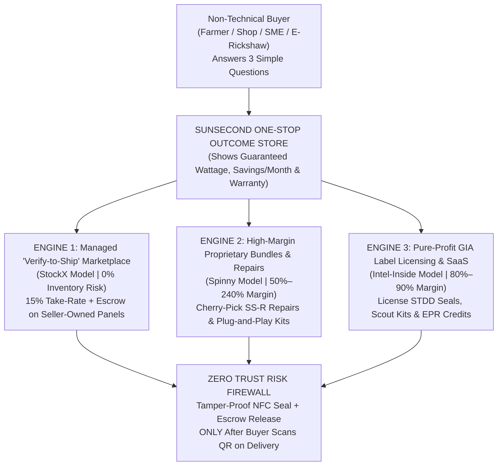
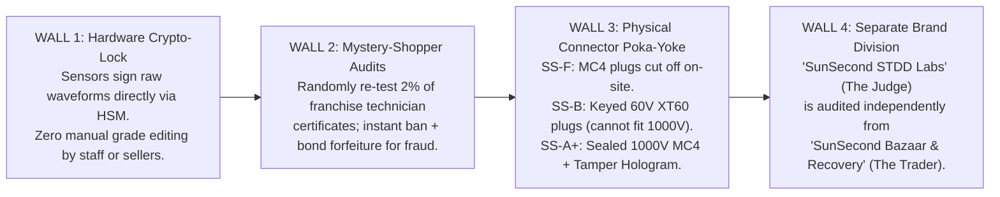

# SunSecond High-Velocity Monetization & Marketplace Engine
**Project: SunSecond** | **Subject: BEC754 — Start-up and Entrepreneurial Activity Assessment**  
**Department of Electronics Engineering, Rajkiya Engineering College, Sonbhadra**  
**Team**: Neeraj (`2308410300042`) & Pankaj (`2308410300044`)

---

## 1. Evaluating Your Marketplace Idea vs. The Better Plan

Your instinct to put **all reusable tiers on a single platform designed for non-technical buyers** is spot-on for demand generation—because ordinary buyers (farmers, shopkeepers, small business owners) do not understand `Voc`, `Impp`, or `Rsh`.

However, running it as a **plain open listing site (like OLX or IndiaMART)** carries two fatal traps:
1. **The Fraud Trap (Kills GIA Trust)**: A shady seller tests a healthy panel to get your certificate, then ships a cracked panel to the buyer. Your brand dies in 6 months.
2. **The Slow-Cash Inventory Trap**: Conversely, if SunSecond buys *every single panel* with its own money before finding a buyer, your cash gets locked in warehouse inventory and growth stalls.

### The Better Plan: The "StockX + Spinny + GIA" 3-Engine Hybrid
Combine **one unified, ultra-simple buyer website/WhatsApp store** with **three parallel money-making engines** behind the scenes:



---

## 2. Designing the Single Site for Non-Tech Users ("The 3-Click Outcome Wizard")

**Rule #1 of Selling Used Solar to Non-Engineers**: *Never sell "Degraded Grade-B 175W Modules."* Sell **Guaranteed Electricity Outcomes** in plain Hindi/English/Regional languages.

```
┌─────────────────────────────────────────────────────────────────────────┐
│                    SUNSECOND.IN — FIND YOUR SOLAR MATCH                 │
│                                                                         │
│  Step 1: What do you want to run?                                       │
│   [ 🏪 Shop Inverter ]  [ 🛺 E-Rickshaw ]  [ 🚜 Farm Pump ]  [ 🏭 Factory ] │
│                                                                         │
│  Step 2: How much open roof / ground space do you have?                 │
│   [ Tight Space ]       [ Normal Roof ]    [ Plenty of Shed/Land ]      │
│                                                                         │
│  Step 3: Pick your budget & warranty:                                   │
│                                                                         │
│  ┌──────────────────────────────┐   ┌──────────────────────────────┐    │
│  │ ⭐ BEST VALUE (SS-B Micro)   │   │ 🛡️ LONG LIFE (SS-A+ Prime)   │    │
│  │ "Kirana Power Box"           │   │ "SME Commercial Pack"        │    │
│  │ • 2× 175W Certified Panels   │   │ • 10× 280W Matched Panels    │    │
│  │ • Plug-in Controller + Wire  │   │ • High-Voltage 1000V Safe    │    │
│  │ • Saves ~₹950/month          │   │ • Saves ~₹4,800/month        │    │
│  │ • 1-Yr Free Swap Guarantee   │   │ • 3-Yr Insured Replacement   │    │
│  │                              │   │                              │    │
│  │ Price: ₹4,499 (or ₹499/mo)   │   │ Price: ₹29,900 (or ₹2,990/mo)│    │
│  │ [ BUY WITH ESCROW LOCK ]     │   │ [ BUY WITH ESCROW LOCK ]     │    │
│  └──────────────────────────────┘   └──────────────────────────────┘    │
└─────────────────────────────────────────────────────────────────────────┘
```

### Why Plug-and-Play Kits Double Your Profit AND Protect Trust
* If you sell a bare `SS-B` 175W panel for ₹1,200, you make ~₹500 margin—and a non-tech buyer might wire it wrong and blame SunSecond!
* If you bundle **2× `SS-B` panels (cost ₹1,100) + 1× 20A PWM/MPPT controller (cost ₹450) + pre-crimped keyed XT60 cables (cost ₹250)** into a ready-to-plug **"SunSecond Power Box"** sold at **₹4,499**:
  1. Your **net profit jumps from ₹500 to ₹2,200+** per order!
  2. The buyer gets a 5-minute plug-and-play setup with **zero wiring mistakes**.
  3. Because the connectors are physically keyed (<60V DC), safety is guaranteed.

---

## 3. The 10 Stacked Revenue Streams (Maximum Cash, Fastest Liquidity)

By turning every single touchpoint of a solar panel's lifecycle into a high-margin transaction, SunSecond builds a **10-layer cash engine**:

| # | Revenue Stream | How You Price It | Gross Margin | Cash Speed | Trust Risk |
| :--- | :--- | :--- | :---: | :---: | :---: |
| **1** | **On-Site Testing & STDD Audit Fee** | ₹149–₹249/panel (Residential) or ₹99–₹150/panel (Bulk >100). Waived/adjusted if they sell to SunSecond! | **65%** | **Day 0 (Instant)** | Zero |
| **2** | **Managed Marketplace Take-Rate** | **12%–18% commission** on seller-owned certified panels sold on SunSecond.in (StockX escrow model—zero inventory cost!). | **85%** | **7–14 Days** | Zero (NFC Verified) |
| **3** | **Repair Arbitrage (`SS-R` Cherry-Pick)** | Buy "dead" diode/J-box panels for ₹450 $\rightarrow$ ₹250 repair $\rightarrow$ sell certified at ₹2,300–₹2,600. | **70%+** | **15–20 Days** | Zero (Re-tested) |
| **4** | **Plug-and-Play Outcome Bundles** | Bundle `SS-A`/`SS-B` panels with MPPT controllers, wires & stands (35%–45% kit markup). | **45%–55%** | **Instant–15 Days** | Lowers risk! |
| **5** | **GIA Label Licensing ("STDD Inside")** | Charge EPCs, refurbishers & exporters **₹0.50–₹1.00/Watt (₹150–₹250/panel)** for official tamper-proof NFC/QR STDD certification seals. | **90%** | **Day 0 (Prepaid)** | Protected via HSM |
| **6** | **Technician `Scout` Kit SaaS Franchise** | Lease `SunSecond Scout` backpack kits to independent solar electricians: **₹3,999/month subscription + ₹50/certificate API fee**. | **80%** | **Monthly Recurring** | Protected via HSM |
| **7** | **Extended Warranty & Swap Insurance** | Optional paid **3-Year / 5-Year Performance Shield** (₹399–₹699/panel). Actuarial failure rate <1.5% = massive high-margin float! | **75%+** | **Day 0 (Upfront)** | Boosts trust! |
| **8** | **Embedded EMI / Fintech Origination** | Partner with NBFCs to offer Zero-Down EMI on ₹5k–₹5L orders. SunSecond earns **3%–5% loan referral fee** + 3× higher conversion. | **95%** | **Day 1 (NBFC Payout)** | Zero |
| **9** | **Instant Spoke Scrap Cash (`SS-F`)** | Condemned panels surrendered free (or with ₹150–₹250 disposal fee). Strip Al frame + Cu cable locally $\rightarrow$ **₹550 instant cash in 48 hrs**. | **60%** | **2 Days** | Zero |
| **10** | **High-Purity Refining + CPCB EPR Credits** | Bulk NIR-sorted de-framed laminates to C-MET/CPCB hubs (Ag + Si + Glass revenue share) + sell **CPCB EPR Credits** to PV OEMs. | **50%–70%** | **30–45 Days** | Boosts legal trust! |

---

## 4. The "Zero-Cheat Psychology": Why Neither Seller Nor Buyer Ever Feels Cheated

The fastest way to destroy a GIA brand is making either side feel squeezed. SunSecond solves this with **three structural fairness guarantees**:

### A. Why the Seller / Owner NEVER Feels Cheated
1. **Published "SunSecond Solar Blue Book"**: Just like Kelley Blue Book for cars, SunSecond publicly displays live daily market rates per guaranteed Watt (e.g., `SS-A+`: ₹11/W, `SS-A`: ₹8.5/W, `SS-B`: ₹6/W, `SS-F` Scrap: ₹450–₹550 metal value).
2. **The Seller's Two-Door Choice (Speed vs. Max Price)**: After the 30-second test, the seller sees the exact live market value on WhatsApp and picks their own deal:
   * **Door 1 — Instant Cash Today**: SunSecond buys it on the spot via UPI at **70%–75% of resale price** (seller gets instant money, zero waiting, zero shipping headache).
   * **Door 2 — Maximum Price Listing**: Seller lists it on SunSecond.in at **100% retail price**; SunSecond takes a flat **15% commission** only when it sells.
   * *Psychology*: Nobody feels cheated when they transparently choose between *fast cash* and *top price* using public rates!
3. **Why Scrap Owners (`SS-F`) Feel Relieved, Not Cheated**: Showing a commercial owner a live 130°C thermal hotspot + handing them a legally valid **CPCB EPR Disposal Manifest & Fire-Risk Clearance** turns a dead liability into instant peace of mind.

### B. Why the Buyer NEVER Feels Cheated
1. **Pay Strictly for True Verified Watts**: Never sell an old 330W panel as "330W used." Sell it strictly by **Guaranteed Tested Output** (e.g., `180W Certified at ₹7.50/W = ₹1,350`).
2. **Escrow-Locked Delivery Verification**: Buyer's money stays safe in SunSecond Escrow. When the panel arrives, the buyer scans the NFC/QR seal with their phone camera to verify the tamper-proof sticker and serial number match the cloud record—**only then** is money released to the seller.
3. **No-Questions-Asked Instant Swap**: If any `SS-A` or `SS-B` panel fails within warranty, the nearest franchise technician swaps it out.

---

## 5. How to Prevent Any Trust Leak (The 4-Wall Governance Firewall)

To scale to ₹100 Crore+ without risking a single scandal that damages your GIA status:



---

## 6. Fast-Scale 3-Year Revenue Trajectory (Asset-Light India Model)

By combining **high-margin cherry-pick resale/kits** with **infinite-scale licensing and marketplace commissions**, SunSecond avoids heavy factory debt while generating explosive cash flow:

| Metric | Year 1 (1 Regional Spoke + 10 Technicians) | Year 2 (4 Solar-Belt Hubs + 100 Franchise Techs) | Year 3 (12 Hubs + 500 Techs + National Label Licensing) |
| :--- | :---: | :---: | :---: |
| **Total Panels Inspected / Certified** | 25,000 panels | 2,50,000 panels | 12,00,000 panels |
| **1. Testing, Label Licensing & SaaS Fees** | ₹45 Lakh | ₹4.8 Crore | ₹24.5 Crore |
| **2. Marketplace Commissions (Managed Escrow)** | ₹28 Lakh | ₹3.6 Crore | ₹18.0 Crore |
| **3. Proprietary `SS-R` Repairs & Power Kits** | ₹1.15 Crore | ₹8.2 Crore | ₹26.0 Crore |
| **4. Scrap Metal (Al/Cu), Ag/Si Share & EPR** | ₹62 Lakh | ₹5.4 Crore | ₹22.5 Crore |
| **5. Warranty Float & NBFC Fintech Fees** | ₹15 Lakh | ₹1.8 Crore | ₹9.0 Crore |
| **TOTAL GROSS REVENUE** | **₹2.65 Crore** | **₹23.8 Crore** | **₹100.0 Crore** |
| **Blended EBITDA Margin** | **~24% (₹64L)** | **~34% (₹8.1 Cr)** | **~41% (₹41.0 Cr)** |
| **Cash Conversion Cycle** | **~12 Days** | **~8 Days** | **Negative Working Capital** *(Upfront Fees + Escrow!)* |

> [!IMPORTANT]
> **The Ultimate Financial Superpower (Negative Working Capital)**: Once Year 2–3 scales, SunSecond collects **upfront testing fees, prepaid STDD label licensing, buyer escrow cash, and 48-hour Aluminum/Copper scrap cash** *before* paying marketplace sellers or hub rent—meaning the business funds its own expansion out of cash flow with minimal equity dilution!
