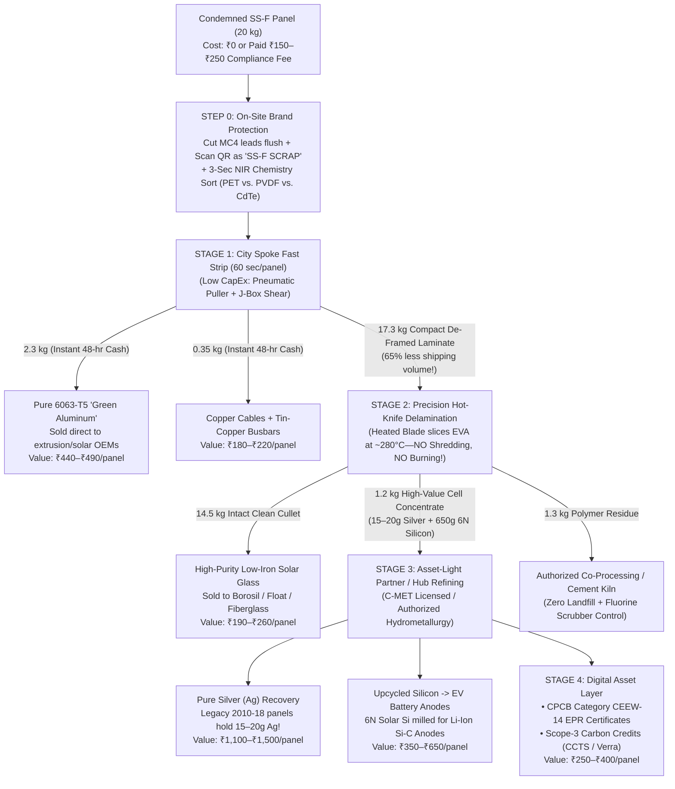
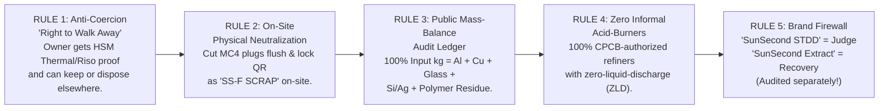

# SunSecond Extract: High-Margin Monetization of Non-Reusable (`SS-F`) Solar Panels
**Project: SunSecond** | **Subject: BEC754 — Start-up and Entrepreneurial Activity Assessment**  
**Department of Electronics Engineering, Rajkiya Engineering College, Sonbhadra**  
**Team**: Neeraj (`2308410300042`) & Pankaj (`2308410300044`)

---

## 1. The Core Problem & The Strategic Pivot

In India, CEEW’s financial modeling proved that **conventional standalone solar recycling loses ₹10,230 to ₹12,431 per tonne** because traditional recyclers make four fatal mistakes:
1. They **pay for whole scrap panels** and haul bulky empty aluminum frames across hundreds of kilometers.
2. They use **hammer-mill shredders** that smash 15 kg of premium low-iron solar glass + 6N pure silicon into contaminated ₹2/kg road filler.
3. They sell pure extruded **6063-T5 solar aluminum** to roadside scrap dealers at commodity rates instead of **Green Aluminum** buyers.
4. They treat recycling purely as metal scrap rather than a **certified ESG, CPCB EPR, and upcycled battery/glass feedstock business**.

**SunSecond Extract flips every single cost driver**—unlocking **₹2,400 to ₹3,100+ in total economic value per 20 kg condemned panel** without compromising SunSecond's GIA-level integrity.

---

## 2. The "Zero-Waste Value Cascade" (Every Gram Monetized)

Instead of shredding a condemned panel into low-value dust, SunSecond separates it by **value density and cash speed** across three modular stages:

---

## 3. The 7 Stacked Monetization Levers for Non-Reusable (`SS-F`) Panels

### Lever 1: "Paid-to-Collect" Intake (Zero or Negative Feedstock Cost)
* **Commercial / Industrial / Utility Clients**: Under India's **E-Waste Rules (Category CEEW-14)** and fire-insurance underwriting rules, factories and solar parks *cannot* legally dump panels or sell them to unregistered *kabadiwalas*.
* **Monetization**: SunSecond charges **₹150–₹300 per condemned panel** as a **Safe Decommissioning, Fire-Hazard Removal & CPCB Compliance Fee** (while offering free zero-hassle pickup to individual homeowners/farmers).
* **Impact**: Eliminates the #1 cost killer identified by CEEW (feedstock purchase cost).

### Lever 2: 48-Hour Spoke Liquidation + The "Green Aluminum" Premium
* **Why Strip Locally**: Shipping whole framed panels wastes 65% of truck space on empty air. Stripping frames at city spokes using a ₹3.5 Lakh semi-automated pneumatic frame puller immediately frees cash AND triples truck payload density.
* **The Margin Multiplier**: Solar frames are made of ultra-clean **6063-T5 extruded aluminum alloy**. Instead of dumping it at local scrapyards for ₹140/kg, SunSecond aggregates alloy-pure, NIR-documented batches and sells directly to Indian aluminum extruders and solar OEMs needing **low-carbon "Green Aluminum"** for **EU CBAM and Scope 3 compliance** at **₹190–₹215/kg** (+35% price premium).
* **Cash Speed**: **24–48 hours** (funds the entire rest of the recovery chain!).

### Lever 3: Hot-Knife Delamination (6×–9× Glass Value Multiplier)
* **The Tech**: Developed globally (e.g., NPC Japan, European automated lines) and easily replicated using Joule-heated tungsten/steel blades (~250°C–300°C). The hot knife cleanly slices through the thin EVA adhesive boundary between the front glass and silicon cells **without crushing the glass or burning the polymer into toxic gas**.
* **The Money**:
  * Conventional shredded glass-silicon dust: ₹1.5–₹2.5/kg (**~₹25/panel**).
  * Hot-knife separated, low-iron solar glass cullet: ₹13–₹18/kg (**~₹190–₹260/panel**) sold straight back to solar glass makers (Borosil Renewables, Saint-Gobain, Asahi) or fiberglass insulation manufacturers.

### Lever 4: The "Legacy Silver Goldmine" (Asset-Light Concentrate Tolling)
* **Hidden Industry Fact**: Modern 2026 TOPCon solar panels use only ~8–10g of silver, **but the 2010–2018 legacy panels dying right now across India contain 15 to 22 grams of pure silver per panel!** At ~₹90/gram, each condemned panel holds **₹1,350–₹1,980 of raw silver**.
* **Asset-Light Day-1 Execution (Zero ₹5 Crore Chemical Plant Needed)**:
  * SunSecond does **not** run hazardous acid tanks in Year 1.
  * After Hot-Knife delamination strips the 14.5 kg of glass, you are left with **~1.2 kg of ultra-concentrated silicon-silver cell sheet per panel**.
  * Shipping 1 ton of this concentrate carries the silver of **~800 panels (worth >₹10 Lakh in silver alone!)**—making freight costs practically zero!
  * SunSecond enters a **tolling / revenue-share agreement** with **C-MET Hyderabad technology licensees or CPCB-authorized hydrometallurgical precious-metal refiners**, capturing **75%–80% of pure silver value** with zero chemical CapEx or pollution risk!

### Lever 5: Next-Gen Upcycling — Turning Solar Silicon into EV Battery Anodes!
* **The Ultimate Value Upgrade**: Conventional recycling downcycles silicon wafers into metallurgical-grade silicon powder (~₹150/kg).
* **The Solar-to-EV Bridge**: Recovered crystalline silicon cells are already **99.9999% (6N) hyper-pure silicon**. Once silver/aluminum paste is cleanly leached away, ball-milling and carbon-coating this reclaimed 6N silicon yields **nano-silicon / Si-C anode precursor material** for Lithium-Ion EV batteries (which holds up to 10× more lithium capacity than graphite).
* **Value Jump**: Instead of ₹150/kg metallurgical scrap (~₹90/panel), selling purified solar silicon feedstock to Indian/global EV battery cell gigafactories and anode startups yields **₹800–₹2,500+/kg** (**₹400–₹900+/panel** in Phase 2/3!).

### Lever 6: NIR Chemistry Pre-Sorting (Higher Refiner Payouts + Zero Toxic Penalties)
* SunSecond's **3-second Portable NIR Scanner** (already paid for by the Reuse Testing Suite!) automatically tags every `SS-F` laminate into 3 clean streams:
  1. **Stream A — Non-Fluorinated PET Backsheet** (Cleanest, cheapest to process $\rightarrow$ highest tolling share).
  2. **Stream B — Fluorinated PVDF/Tedlar Backsheet** (Isolated strictly for mechanical backsheet peeling or scrubber-equipped thermal lines $\rightarrow$ prevents toxic Hydrofluoric acid (HF) releases and legal shutdowns).
  3. **Stream C — Thin-Film Modules (CdTe / CIGS)** (Never mixed with silicon! Routed directly to dedicated thin-film recyclers like First Solar Chennai to safely recover Cadmium/Tellurium/Indium).

### Lever 7: Digital Compliance Monetization (CPCB EPR + Carbon Credits + ESG Fees)
Because every panel is tracked via its **cryptographic Digital Material Passport**, SunSecond monetizes the *verified data* alongside the physical atoms:
1. **CPCB Category CEEW-14 EPR Certificates**: Registered producers/importers must offset solar waste on the CPCB portal. Verified recycling mass generates tradeable EPR credits (~₹150–₹250/panel equivalent).
2. **Carbon Credits (India CCTS / Voluntary Registries)**: Recycling 1 tonne (50 panels) avoids **1.4–1.8 tonnes of \(\text{CO}_2\text{e}\)** compared to mining virgin aluminum, silicon, and glass—monetizable as corporate Scope-3 offsets (~₹100–₹150/panel).
3. **Corporate "Zero-Landfill Audit Certificate"**: Large Indian/global enterprises (data centers, auto factories, MNC warehouses) pay a compliance premium for an immutable QR-verified ESG certificate showing 100% documented mass-balance recovery.

---

## 4. Unit Economics Proof: Flipping CEEW's Loss Into High Profit

Comparison per **1 Metric Tonne (~50 Condemned 20 kg `SS-F` Panels)**:

| Financial Line Item (Per Tonne / 50 Panels) | Unorganized *Kabadiwala* (Illegal Dumping) | Conventional Shredding *(CEEW Benchmark)* | **SunSecond Extract (Phase 1: Asset-Light Tolling)** | **SunSecond Extract (Phase 2: Hot-Knife + EV-Si Upcycling)** |
| :--- | :---: | :---: | :---: | :---: |
| **1. Feedstock Cost / Compliance Fee** | -₹15,000 (Buys scrap) | -₹10,000 (Buys scrap) | **+₹5,000** *(Net Avg Intake Fee)* | **+₹7,500** *(Enterprise Compliance)* |
| **2. Aluminum (115 kg) & Copper (18 kg)** | +₹22,000 | +₹24,000 | **+₹32,000** *(Green 6063 Premium)* | **+₹34,000** *(Green 6063 Premium)* |
| **3. Solar Glass (725 kg)** | ₹0 *(Dumped)* | +₹1,500 *(Mixed cullet)* | **+₹9,500** *(Clean Hot-Knife Glass)* | **+₹12,500** *(Low-Iron Solar Grade)* |
| **4. Silver Recovery (~750g–900g/tonne)** | ₹0 *(Lost)* | +₹22,000 *(Low yield)* | **+₹55,000** *(Clean Concentrate Share)* | **+₹68,000** *(Direct Green Leaching)* |
| **5. Silicon Recovery (~32 kg/tonne)** | ₹0 *(Lost)* | +₹3,500 *(Dust)* | **+₹6,500** *(Metallurgical / Kerf)* | **+₹28,000** *(EV Battery Anode Precursor)* |
| **6. CPCB EPR + Carbon Credits** | ₹0 | ₹0 | **+₹12,500** | **+₹16,000** |
| **GROSS VALUE EXTRACTED / TONNE** | **₹22,000** | **₹51,000** | **₹1,20,500** | **₹1,66,000** |
| **Logistics, Stripping & Refining Costs** | -₹3,000 | -₹61,230 | **-₹58,000** *(Local strip + Tolling)* | **-₹68,000** *(Automated Hub)* |
| **NET PROFIT / (LOSS) PER TONNE** | *+₹4,000 (Illegal/Toxic)* | **-₹10,230 (LOSS)** | **+₹62,500 (+₹1,250/panel!)** | **+₹98,000 (+₹1,960/panel!)** |

---

## 5. The 5-Rule "Zero-Brand-Damage" Scrap Governance Firewall

Aggressively monetizing scrap carries **three reputation risks** that could destroy a GIA-level standard if mishandled. SunSecond neutralizes all three permanently:

1. **Rule 1 — Zero Coercion (Destroys "Fake Fail" Suspicion)**:
   * When a panel fails (`SS-F`), the owner receives the **HSM-signed raw failure proof** (glowing hotspot photo or `Riso` safety failure) directly on WhatsApp and is **100% free to decline pickup**. Because SunSecond *also* makes massive profits on reusable panels (`SS-A`/`SS-R`), there is zero economic incentive to falsely condemn a working panel!
2. **Rule 2 — Irreversible On-Site Neutralization (Zero Grey-Market Leakage)**:
   * The #1 nightmare for a GIA brand is a condemned fire-hazard panel secretly getting stolen and resold to a villager with your sticker on it.
   * The moment the owner approves `SS-F` handover, the technician **clips the MC4 cables flush at the junction box**, punches a bright red `SS-F CONDEMNED` seal, and permanently flips the panel's cloud QR status to **`DANGER — CONDEMNED SCRAP (ILLEGAL TO INSTALL)`**.
3. **Rule 3 — Open Mass-Balance Accountability (Zero Greenwashing)**:
   * Corporate ESG buyers scan their batch certificate and see exact reconciled weights: *1,000 kg Input = 115 kg Green Al + 18 kg Cu + 725 kg Solar Glass + 32 kg Si + 0.8 kg Ag + 110 kg Co-Processed Polymer (0.0 kg Landfilled)*.
4. **Rule 4 — Strict Zero-Informal-Downstream Pledge**:
   * SunSecond signs legally binding zero-diversion contracts with **CPCB-registered Tier-1 recyclers** only—never passing hazardous lead solder or fluorinated polymers into unorganized *kabadiwala* acid pits.
5. **Rule 5 — Structural Brand Firewall**:
   * Keep **`SunSecond STDD Labs`** (testing & certification) operationally and auditable separate from **`SunSecond Extract`** (material recovery), inviting annual third-party NABL / CPCB audits published publicly on the website.

---

## 6. Asset-Light Phased Rollout for `SunSecond Extract`

| Phase | Infrastructure Needed | CapEx | How You Make Money Immediately |
| :--- | :--- | :---: | :--- |
| **Phase 1 (Months 1–12): Spoke Stripper + Concentrate Aggregator** | 1 Pneumatic Frame Puller + J-Box Shear + Weighing Scale + CPCB Recycler Tolling Contract | **₹5–₹8 Lakh** | Instant 48-hr cash from Green Al + Cu + CPCB disposal fees + tolling share on whole de-framed laminates. |
| **Phase 2 (Months 12–24): In-House Hot-Knife Delamination Hub** | Automated Hot-Knife Delamination Machine + NIR Sorter + Clean Glass Cullet Bins | **₹25–₹40 Lakh** | Capture 6× glass margin directly + ship ultra-dense 1.2 kg/panel Silver-Silicon concentrates for maximum refiner payout (**+₹62,500/tonne net profit**). |
| **Phase 3 (Months 24–48): Solar-to-EV Upcycling & Green Leaching** | C-MET Licensed Hydrometallurgical Line (Silver/Lead) + Nano-Silicon Ball-Milling Partner | **₹2–₹4 Crore** *(Series A / Green Debt)* | Full vertical capture: Pure Silver ingots + EV Battery Silicon Anode Precursors + Carbon Credits (**+₹98,000/tonne net profit**). |
