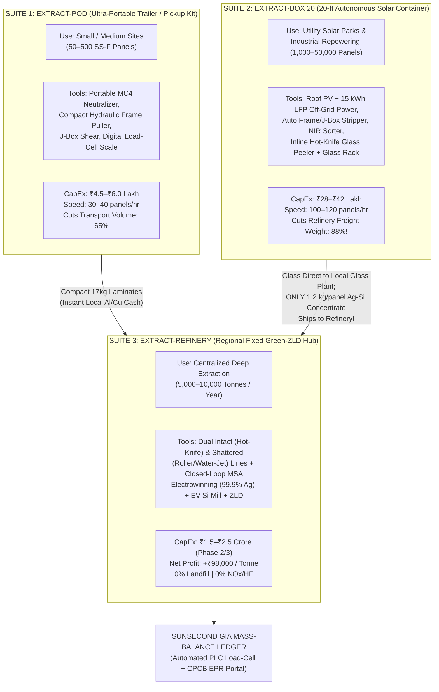

# SunSecond Scrapping & Extraction Suites: Toxin-Free Master Architecture
**Project: SunSecond** | **Subject: BEC754 — Start-up and Entrepreneurial Activity Assessment**  
**Department of Electronics Engineering, Rajkiya Engineering College, Sonbhadra**  
**Team**: Neeraj (`2308410300042`) & Pankaj (`2308410300044`)

---

## 1. The Engineering Objective & Global Benchmarks

To uphold **SunSecond's GIA-level brand standard**, our scrapping division (`SunSecond Extract`) must satisfy five simultaneous constraints that no single legacy recycler in India meets today:
1. **Maximum Value Extraction**: Preserve unbroken low-iron solar glass, alloy-pure 6063 aluminum, 99.9% silver, copper, and 6N silicon (never downcycle into ₹2/kg mixed dust).
2. **100% Toxin-Free & Zero-Emission**: Strictly **NO open EVA pyrolysis** (emits dioxins/HF gas) and **NO raw Nitric Acid / Aqua Regia baths** (emits toxic brown \(\text{NO}_x\) fumes and acid sludge).
3. **High Speed & Low OpEx**: Under 60 seconds per panel for front-end stripping and delamination.
4. **Right-Sized Portability**: Slash 65%–85% of logistics freight by doing mechanical volume reduction *at or near the site*, keeping complex closed-loop electrochemistry at regional Zero-Liquid-Discharge (ZLD) hubs.
5. **Audit-Grade Mass-Balance Trust**: Automated electronic weighing & sensor interlocks proving 0% landfilling and 0% informal leakage.

### Global Industry Benchmarks Evaluated

| Global Leader / Method | Architecture Type | Throughput | Key Strength | Limitation for India Launch |
| :--- | :--- | :--- | :--- | :--- |
| **Ecoprogetti `Ecomove` (Italy)** | 20-ft solar-powered mobile container | ~120 panels/hr (3 t/hr) | Slashes freight volume by **70%** via on-site frame & J-box stripping | Imported CapEx is high; pre-processing only (no refining) |
| **NPC `Hot-Knife` (Japan)** | Inline thermo-mechanical peeler (~300°C) | **40–60 sec / panel** | Peels **pristine intact flat solar glass** (6×–9× value) with zero emissions | Works cleanly **only on unbroken glass** panels |
| **SELFRAG `HVPF` (Switzerland)** | High-voltage underwater pulse (100–200 kV) | Batch mineral mode | Liberates silver/silicon along dielectric boundaries; handles shattered panels | High CapEx, electrode wear, outputs mixed slurry needing heavy sorting |
| **ROSI Solar / SOLARCYCLE** | Centralized industrial refineries | 10,000–30,000 t/yr | >95% value recovery (high-purity Ag, Si, Glass) | Requires €15M–€20M+ CapEx; unviable for Day-1 Indian launch |
| **C-MET Hyderabad (India)** | Indigenous mechanical + thermal + chemical | Pilot-to-commercial | Proven 70 kg glass + 3.5 kg Si + Ag per 100 kg de-framed laminate | Requires controlled chemical hub & scrubber infrastructure |

---

## 2. Encyclopedia of 10 Clean Scrapping & Extraction Technologies

A critical real-world engineering truth: **not all condemned (`SS-F`) panels arrive in the same physical shape.** Roughly **65%–70% have intact glass** (failed insulation, PID, severe hotspots, repowered dead panels), while **30%–35% have shattered glass** (hailstorms, transit breakage). SunSecond routes them through a **Dual-Path Delamination Engine** paired with **Toxin-Free Closed-Loop Electrochemistry**.

### Stage 1: Mechanical Front-End & Chemistry Pre-Sorting *(Portable / Mobile)*
1. **Automated Pneumatic Frame Puller & J-Box Shear**
   * *How*: Clamps corners and hydraulically pulls the 4 extruded **6063-T5 Aluminum** rails off without cutting/shredding (preserving 100% pure alloy grade) while shearing off the copper junction box & cables in **< 35 seconds**.
   * *Toxin-Free*: 100% dry, zero heat, zero dust.
2. **Portable NIR Polymer & Chemistry Gate (900–1700 nm)**
   * *How*: 3-second optical scan isolates **Non-Fluorinated PET** backsheets, **Fluorinated PVDF/Tedlar** backsheets (prevents accidental HF gas generation), and **Thin-Film CdTe/CIGS** (diverted strictly to dedicated thin-film partners).

### Stage 2: Delamination — Separating Glass, EVA & Silicon *(Dual-Path Architecture)*
3. **Path A (Intact Glass — ~70% of Volume): Precision `Hot-Knife` Thermo-Mechanical Peeling**
   * *Physics*: A PID-controlled Joule-heated tungsten/steel blade (~280°C–300°C — *below* polymer pyrolysis/burning temperature!) glides linearly through the EVA layer at 40–60 sec/panel.
   * *Output*: **Unbroken, crystal-clear low-iron solar glass sheet** (worth ₹13–₹18/kg direct to Borosil/Saint-Gobain/AGC) + a thin 1.2 kg polymer-silicon-silver laminate sheet!
   * *Toxin-Free*: Operates strictly below EVA/PVDF thermal decomposition thresholds $\rightarrow$ **zero smoke, zero dioxins, zero HF gas**!
4. **Path B (Shattered Glass — ~30% of Volume): Dry Precision Roller-Abrasion / High-Pressure Water-Jet Milling**
   * *Why Needed*: A Hot-Knife jams on shattered glass shards.
   * *How*: Shattered panels pass through calibrated diamond-coated counter-rotating micro-rollers (with HEPA dry suction) OR high-pressure closed-loop water-jet milling that strips shattered glass fragments cleanly off the flexible EVA/cell sheet without pulverizing the silicon wafers into dust.
5. **Advanced Alternative (Path B Upgrade): High-Voltage Pulse Fragmentation (HVPF / Electrodynamic Shockwave)**
   * *Electronics/HV Physics*: Nanosecond 100–150 kV Marx-generator pulses inside a closed water tank travel along dielectric phase boundaries (glass/EVA/silicon), selectively liberating pure silver contacts and silicon grains without mechanical blade wear. *(Best suited for Phase-3 centralized high-tonnage hubs).*
6. **Emerging Frontier: High-Intensity Pulsed Light (HIPL) / Ultrafast Laser Debonding**
   * *Physics*: Millisecond xenon/laser flash passes transparently through front glass and is absorbed instantly by the silicon anti-reflective layer (\(\text{SiN}_x\)), popping the glass-EVA bond in seconds without heating the bulk panel. *(Watch closely for 2028–2030 Phase-3 upgrades as laser CapEx drops).*
7. **Evaluated & REJECTED for India: Cryogenic Liquid Nitrogen (\(\text{LN}_2\)) Embrittlement & Bulk Pyrolysis**
   * *Why Rejected*: Cryogenic \(\text{LN}_2\) consumes massive ongoing OpEx (~₹350–₹500/panel in liquid nitrogen alone—destroying Indian unit economics). Bulk thermal pyrolysis (>450°C) emits hazardous VOCs/HF requiring expensive scrubbers and violates SunSecond's zero-toxin brand promise.

### Stage 3: Toxin-Free Chemical & Electrochemical Metal Extraction *(Fixed Regional ZLD Hub)*
8. **Green Silver Recovery: Biodegradable Methanesulfonic Acid (MSA) + \(\text{H}_2\text{O}_2\) + Closed-Loop Electrowinning** *(The Crown Jewel!)*
   * *Why It Beats Nitric Acid*: Traditional \(\text{HNO}_3\) produces lethal brown \(\text{NO}_x\) fumes and hazardous nitrate wastewater. **Methanesulfonic Acid (\(\text{CH}_3\text{SO}_3\text{H}\))** is non-volatile, biodegradable, highly conductive, and emits **zero toxic fumes**:
     $$2\text{Ag} + \text{H}_2\text{O}_2 + 2\text{CH}_3\text{SO}_3\text{H} \longrightarrow 2\text{Ag}^+ + 2(\text{CH}_3\text{SO}_3)^- + 2\text{H}_2\text{O}$$
   * *Electrochemical Closed Loop*: The silver-rich MSA flows directly into a **potentiostat-controlled electrowinning cell** (pure electrical engineering!). Applying a precise DC cathode voltage plates **99.5%–99.9% elemental Silver directly onto stainless-steel cathodes** (95%–99% recovery) while **regenerating the MSA electrolyte** for continuous reuse—creating a **Zero-Liquid-Discharge (ZLD)** closed loop!
9. **Dry Electrostatic & Eddy-Current Separation (Copper Ribbons, Solder & Polymer)**
   * *How*: After silver leaching, dry tribo-electrostatic separators split non-conductive EVA/PET polymer flakes from conductive **Copper-Tin-Lead busbar ribbons** and **pure Silicon fragments** with >98% purity and zero water pollution.
10. **Solar-Silicon Upcycling $\rightarrow$ EV Lithium-Ion Battery Anodes**
    * *How*: Recovered 6N solar silicon (already 99.9999% pure) undergoes mild alkaline aluminum-BSF cleaning + precision ball-milling & carbon-coating into **Si-C anode precursor** for EV batteries—multiplying silicon value **5×–10×** over metallurgical scrap.

---

## 3. Master Decision Matrix: Which Scrapping Tech to Adopt Now vs. Later

| Technology | Money Extracted | Toxin-Free Score | Speed / Panel | India CapEx Feasibility | Portability | **SunSecond Verdict** |
| :--- | :---: | :---: | :---: | :---: | :---: | :--- |
| **Pneumatic Frame + J-Box Stripper** | ★★★★★ (48-hr cash) | ★★★★★ (100% Dry) | 35 sec | ★★★★★ (₹3.5L) | **Portable / Van** | ✅ **ADOPT DAY 1** |
| **Portable NIR Backsheet Sorter** | ★★★★☆ (Prevents fines) | ★★★★★ (Optical) | 3 sec | ★★★★☆ (₹2L) | **Handheld** | ✅ **ADOPT PHASE 1** |
| **`Hot-Knife` Glass Delamination** | ★★★★★ (6×–9× Glass) | ★★★★★ (Zero Burn) | 45–60 sec | ★★★★☆ (₹18L–₹28L) | **Container / Hub** | ✅ **ADOPT PHASE 2** |
| **Dry Roller / Water-Jet (Shattered)** | ★★★★☆ (Clean Si) | ★★★★☆ (Closed H2O) | 60 sec | ★★★★☆ (₹15L–₹22L) | **Hub Fixed** | ✅ **ADOPT PHASE 2** |
| **Green MSA + Electrowinning (Ag)** | ★★★★★ (99% Silver!) | ★★★★★ (No NOx/ZLD) | Batch (Inline) | ★★★☆☆ (₹45L–₹80L) | **Hub Fixed** | ✅ **PARTNER PH-1 $\rightarrow$ OWN PH-2/3** |
| **HVPF (SELFRAG High-Voltage)** | ★★★★☆ (Deep lib.) | ★★★★★ (Water only) | Batch | ★★☆☆☆ (High CapEx) | **Hub Fixed** | ⏳ **DEFER TO PHASE 3** |
| **Laser / HIPL Optical Debonding** | ★★★★★ | ★★★★★ | 20–30 sec | ★★☆☆☆ (Emerging) | **Hub Fixed** | ⏳ **R&D WATCH (2028+)** |
| **Hammer-Mill Shredding** | ★☆☆☆☆ (Loses ₹10k/t) | ★★☆☆☆ (Pb dust) | 10 sec | ★★★★★ | Container | ❌ **NEVER USE** |
| **Open Pyrolysis / Nitric Acid** | ★★★☆☆ | ❌ **TOXIC** | Slow | ★★★★☆ | Fixed | ❌ **STRICTLY BANNED (Kills GIA Brand)** |
| **Cryogenic \(\text{LN}_2\) Freezing** | ★★★☆☆ | ★★★★★ | 60 sec | ★☆☆☆☆ (High OpEx) | Fixed | ❌ **UNECONOMICAL IN INDIA** |

---

## 4. The Three SunSecond Scrapping Suites (Portable $\rightarrow$ Container $\rightarrow$ Fixed Refinery)

Mirroring our 3 Testing Suites (`Scout`, `Express-Van`, `Vault-Hub`), SunSecond deploys **3 modular Extraction Suites** engineered so **freight is minimized on-site while chemistry stays strictly inside certified ZLD hubs**:

### Why `Extract-Box 20` Is a Logistics Game-Changer for India
Look at the freight physics of a 20 kg condemned solar panel at a Rajasthan or Gujarat solar park:
* **Unprocessed Panel**: 20 kg (high air volume) $\rightarrow$ a 10-ton truck holds only ~350–400 panels.
* **After `Extract-Box 20` On-Site Processing**:
  * **2.3 kg Green Aluminum** + **0.35 kg Copper** $\rightarrow$ sold locally within 48 hours!
  * **14.5 kg Pristine Hot-Knife Solar Glass** $\rightarrow$ shipped straight to the nearest Gujarat/Rajasthan glass furnace (e.g., Borosil Bharuch) on local flatbed trucks!
  * **ONLY ~1.2 kg per panel of Silver-Silicon Cell Concentrate** travels to the `Extract-Refinery`!
  * **Result**: A single 10-ton truck carries the silver and silicon concentrate of **~8,000 solar panels (worth >₹1.1 Crore in Silver + Silicon!)**—slashing chemical-refinery logistics costs by **>88%**!

---

## 5. Electronics Engineering Instrumentation Built Into Every Scrapping Suite

As an **Electronics Engineer**, you don't just buy off-the-shelf steel machinery—you embed **precision control & GIA-grade cryptographic auditing** into every scrapping machine:

1. **PID Thermal & Force Feedback Controller (Hot-Knife Blade)**:
   * An **STM32 / Industrial PLC** closed-loop PID controller regulates blade temperature strictly at **285°C \(\pm\) 3°C** using K-type thermocouples and monitors stepper-motor torque current. If torque spikes (indicating a hidden glass crack), the blade auto-retracts in 20 ms to prevent shattering and routes the panel to Path B!
2. **Real-Time VOC & Hydrofluoric Acid (HF) Gas Safety Interlock**:
   * Low-cost electrochemical **HF + VOC MEMS gas sensors** mounted above the delamination hood continuously log air quality to the cloud. If a fluorinated PVDF backsheet accidentally enters the thermal zone and spikes >1 ppm, the PLC **auto-halts the heater instantly**—guaranteeing 100% worker safety and audit-proof green compliance.
3. **Potentiostat DC Power Electronics (MSA Silver Electrowinning)**:
   * Precision programmable constant-voltage/constant-current (CV/CC) buck rectifier maintains exact cathodic overpotential so **only Silver (\(\text{Ag}^+\)) plates out at 99.9% purity** while Copper/Lead stay separated for sequential staged recovery.
4. **Tamper-Proof Automated Mass-Balance Scale (HSM-Signed)**:
   * Every `Extract-Pod`, `Extract-Box 20`, and `Extract-Refinery` has integrated **HX711 / Industrial Load-Cell Weighing Conveyors** signed by an HSM chip. As panels enter (`SS-F` QR scanned) and outputs exit (Al bin, Cu bin, Glass rack, Ag-Si bag), the cloud automatically verifies:
     $$W_{\text{input}} = W_{\text{Al}} + W_{\text{Cu}} + W_{\text{Glass}} + W_{\text{Ag-Si}} + W_{\text{Polymer}} \quad (\pm 1\% \text{ tolerance})$$
   * This mathematical mass-balance proof makes SunSecond's **CPCB Category CEEW-14 EPR Certificates** and **Corporate Zero-Landfill ESG Reports** completely impossible to fake—cementing the **GIA for Solar** monopoly on *both* reuse and recycling!

---

## 6. Suite-by-Suite Capital, Throughput & Payback Summary

| Scrapping Suite | Deployment Phase | CapEx (India Build) | Processing Cost / Panel | Net Value Extracted / Panel | Net Profit / Panel | Suite Payback Period |
| :--- | :--- | :---: | :---: | :---: | :---: | :---: |
| **Suite 1: `Extract-Pod`** *(Pickup/Spoke)* | **Phase 1 (Day 1 — Included in Unit-1)** | **₹4.5–₹6.0 Lakh** | ₹120 *(Strip + local ops)* + Partner toll | ₹1,250 *(Al/Cu + Partner Ag/Si/EPR share)* | **+₹650 / panel** *(+₹32.5k/t)* | **~3–4 Months** |
| **Suite 2: `Extract-Box 20`** *(Mobile Container)* | **Phase 2 (Month 12–24)** | **₹28–₹42 Lakh** | ₹210 *(Strip + Hot-Knife + Glass)* | ₹1,950 *(Green Al + Solar Glass + Dense Ag-Si + EPR)* | **+₹1,250 / panel** *(+₹62.5k/t)* | **~7–9 Months** |
| **Suite 3: `Extract-Refinery`** *(Regional ZLD Hub)* | **Phase 2/3 (Month 24–36)** | **₹1.5–₹2.5 Crore** | ₹480 *(Full dual-path + MSA Electrowinning + ZLD)* | ₹2,650–₹3,100 *(+EV Battery Si Anode)* | **+₹1,960 / panel** *(+₹98.0k/t)* | **~12–16 Months** |

> [!TIP]
> **The Winning Capital Sequence**: Never build Suite 3 (`Extract-Refinery`) on Day 1! Start with **Suite 1 (`Extract-Pod` — ₹4.5L)** inside Unit-1 paired with a CPCB-registered refiner tolling contract $\rightarrow$ fund **Suite 2 (`Extract-Box 20` — ₹35L)** out of Year-1 profits to capture 6× glass value and deploy directly to mega solar parks $\rightarrow$ launch **Suite 3 (`Extract-Refinery`)** only once 3–5 hubs guarantee 5,000+ tonnes/year of captive feedstock!
