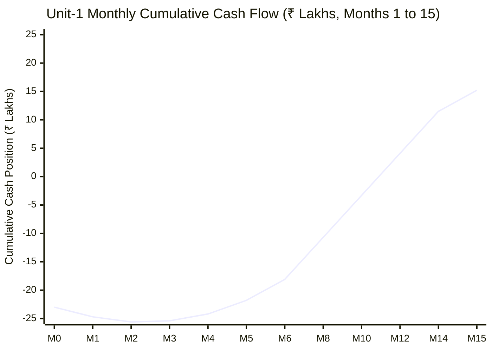
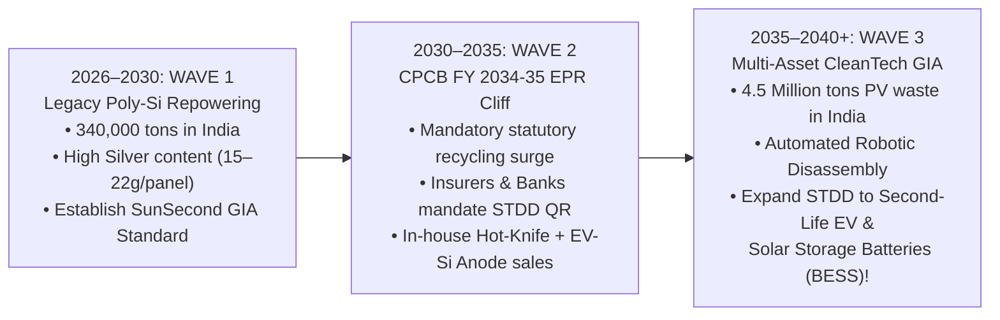

# SunSecond: Ground-Reality Financial Model, Unit-1 Launch Plan & Future Roadmap
**Project: SunSecond** | **Subject: BEC754 — Start-up and Entrepreneurial Activity Assessment**  
**Department of Electronics Engineering, Rajkiya Engineering College, Sonbhadra**  
**Team**: Neeraj (`2308410300042`) & Pankaj (`2308410300044`)

---

## 1. Realistic Market Evaluation (Separating Hype From Captureable Reality)

Grand national TAM numbers (340,000 tonnes by 2030) sound exciting in a pitch deck, but a real entrepreneur must ask: **"How many retired panels can ONE city hub realistically touch every month in Year 1?"**

### Where to Launch Unit-1 (The "Solar Density" Rule)
Do **not** launch in a low-solar metro with expensive warehouse rents. Launch Unit-1 on the industrial outskirts of a **High-Density Indian Solar Belt** where utility farms, factories, EPC installers, and rural agri-buyers coexist within a 150 km radius:
* **Top 3 Optimal Launch Cities**: **Ahmedabad / Sanand (Gujarat)**, **Jaipur (Rajasthan)**, or **Pune / Chakan (Maharashtra)**.

### Realistic Year-1 Supply Funnel (Within 150 km of Unit-1)
* **Addressable Local Installed Base**: ~3–5 GW of older (2012–2020) utility, factory, and commercial solar installations (~10–15 million panels).
* **Realistic Annual Retirement / Damage / Repowering Rate (~1.2%–1.5%/yr)**: ~1,50,000+ damaged, degraded, or repowered panels generated *every year* within driving distance.
* **SunSecond Unit-1 Target Capture (Year 1 Steady State)**: Just **800 panels/month (9,600 panels/year)**—less than **6.5% of the local addressable scrap/retired pool**.
  * *Reality Check*: 800 panels/month equals only **~31 panels per working day** (roughly 1 small factory roof upgrade per week + 2–3 daily residential/farm calls).

---

## 2. Minimum Initial Cost: Launching ONE Complete Dual-Sector Hub ("Unit-1")

How do you establish **BOTH** the Reusable (`STDD` Testing + Repair + Resale) **AND** the Scrappable (`Extract` Frame Stripping + Partner Refining) sectors on the **minimum realistic capital** without buying a ₹3 Crore factory on Day 1?

**Key Lean Rule**: Own the **Testing, Repair, and Local Aluminum/Copper Stripping** in-house (low CapEx, instant cash); outsource heavy **Stage-3 Chemical Silver/Silicon Refining** via a **tolling/revenue-share contract** with an existing CPCB-registered recycler in Year 1.

| Category | Exact Line Items Included in Unit-1 | Minimum Cost (₹) |
| :--- | :--- | :---: |
| **1. Testing & STDD Hardware** | • 2× `SunSecond Scout` Backpack Kits (Dark I-V, AC-IS, Dry Hi-Pot, UVF Hood, Thermal, HSM @ ₹1.40L) • 1× Spoke Rapid Mist Wet-Leakage Tray + Reference Flasher Bench (₹1.80L) | **₹4,60,000** |
| **2. Scrap Stripping & Repair Lab** | • 1× Pneumatic Aluminum Frame Puller + J-Box Shear + Glass Worktable + Digital Scale (₹3.50L) • 1× Repair Station (Smart J-Box/Ideal Diode spares, XT60/MC4 crimpers, NFC/QR Printer) (₹0.90L) | **₹4,40,000** |
| **3. Facility & Pickup Logistics** | • 2,200 sq ft Industrial Shed Deposit (3 mo @ ₹40k) + Pallet Racks & Hand Pallet Jack (₹2.00L) • Used/New Commercial Pickup Van Downpayment (Tata Ace/Bolero) + Padded Panel Racks (₹2.20L) | **₹4,20,000** |
| **4. Legal, Compliance & Software** | • Pvt Ltd Registration, GST, SPCB Collection Authorization + CPCB Recycler Partner MoU • MVP Cloud Ledger, WhatsApp Booking Bot & Outcome-Wizard Website (₹1.80L) | **₹1,80,000** |
| **SUBTOTAL: FIXED SETUP CAPEX** | **Complete Dual-Sector Operational Establishment** | **₹15,00,000** |
| **5. Working Capital & Buffer** | • Instant UPI Buyback Cash Float (₹4.00L) • 3-Month Survival & Ramp-Up Cash Runway (₹4.00L) | **₹8,00,000** |
| **TOTAL MINIMUM CAPITAL (UNIT-1)** | **All-In Launch Budget (~\$27,500 USD)** | **₹23,00,000** |

> [!TIP]
> **Ultra-Lean Student / Grant Pilot Path (₹8.5–₹10 Lakh)**: If launching straight out of college using **DST NIDHI-PRAYAS (₹10L grant)** or **Startup India Seed Fund**, start with 1 `Scout` kit, rent a pickup truck per trip instead of buying, share a 1,000 sq ft shed, and operate purely on Managed Marketplace + local stripping before scaling to the full ₹23L Unit-1 setup.

---

## 3. Day-to-Day Running Costs (Unit-1 Monthly OpEx)

Every single rupee required to keep Unit-1 running smoothly 26 working days/month:

| Monthly Expense Head | Operational Breakdown | Monthly Cost (₹) |
| :--- | :--- | :---: |
| **Industrial Workshop Rent** | 2,200 sq ft ground-floor shed with 3-phase power (Tier-2 industrial outskirt) | ₹40,000 |
| **Core Payroll (6 Team + Founder)** | • 2× Field Testing/Install Techs (₹22k each = ₹44k) • 2× Workshop Staff: Repair & Frame Stripper (₹18k each = ₹36k) • 1× Operations / EPC Sales Coordinator (₹30k) • 1× Van Driver / Helper (₹18k) • Founder Subsistence Stipend (₹30k) | ₹1,58,000 |
| **Logistics & Vehicle Ops** | Van EMI (₹16k) + Diesel/EV Charging (₹20k) + Maintenance/Tolls (₹6k) | ₹42,000 |
| **Utilities & Tech Stack** | 3-Phase Electricity, Water, Fiber Internet, AWS Cloud, WhatsApp Business API | ₹18,000 |
| **Consumables & Local Marketing** | Tamper-Proof NFC/QR Labels, Packaging, EPC Flyers, Rural Meta/WhatsApp Ads | ₹22,000 |
| **Insurance & Warranty Reserve** | Public Liability / Shop Fire Insurance + Baseline Swap Warranty Reserve | ₹20,000 |
| **TOTAL MONTHLY RUNNING COST** | **Fixed Monthly Burn (OpEx)** | **₹3,00,000 / mo** |

---

## 4. Break-Even, Monthly Profit & ROI Reality Check (Unit-1)

Assuming a **conservative steady-state month of 800 panels** (~16 tonnes/month) split realistically across streams:

| Stream (800 Panels / Month) | Monthly Volume | Conservative Net Contribution / Panel | Monthly Gross Contribution (₹) |
| :--- | :---: | :---: | :---: |
| **1. Managed Marketplace Resale (`SS-A`/`SS-B`)** | 150 panels | ₹315 *(15% commission on ₹2,100 avg)* | ₹47,250 |
| **2. Proprietary Buyback & Power Kits (`SS-A`/`SS-B`)** | 150 panels | ₹950 *(Net after buyback, controller, wires)* | ₹1,42,500 |
| **3. Repair Arbitrage (`SS-R` $\rightarrow$ `SS-A`)** | 100 panels | ₹1,400 *(Buy ₹450 + Fix ₹250; Sell ₹2,100)* | ₹1,40,000 |
| **4. Condemned Scrap (`SS-F` Phase-1 Asset-Light)** | 400 panels | ₹650 *(Al/Cu ₹520 + Refiner/EPR ₹350 + Fee ₹100 − ₹320 cost)* | ₹2,60,000 |
| **5. Net Testing & STDD Audit Fees** | 800 panels | ₹100 *(Avg non-waived inspection fee)* | ₹80,000 |
| **TOTAL MONTHLY GROSS CONTRIBUTION** | **800 panels** | **₹837.2 blended avg / panel** | **₹6,69,750** |
| **Less: Fixed Monthly Running Cost (OpEx)** | | | **-₹3,00,000** |
| **NET MONTHLY OPERATING PROFIT (EBITDA)** | | **55.2% Net Margin on Contribution** | **₹3,69,750 / mo** |

### Core Financial Ratios (Unit-1)
* **Operational Break-Even Volume**: \(\frac{₹3,00,000}{₹837.2/\text{panel}} = \) **~360 panels/month (~14 panels per working day)**.
* **Time to Operational Break-Even**: **Month 4** (Ramp-up: M1=150, M2=250, M3=380, M4=500, M6=800 panels).
* **Full Capital Payback Period (₹23 Lakh)**: **11 to 13 Months**.
* **Year-2 Steady-State Profit (Unit-1 Alone)**: **~₹44.4 Lakh / year**.
* **Annualized Cash-on-Cash ROI**: **~193% per year** on the ₹23 Lakh invested!

---

## 5. Generating Real Wealth: Cash Flow vs. Venture Valuation

There are **two distinct wealth layers** in SunSecond:
1. **Cash-Flow Wealth (Local Scrapyard/Trading Trap)**: Running 1 hub generates ₹44L/year profit (a great small business, valued at only 3×–4× profit = ₹1.5 Cr).
2. **Generational Equity Wealth (The "GIA + Platform" Multiplier)**: Because SunSecond owns the **cryptographic STDD certification standard, `Scout` technician SaaS network, and managed marketplace**, investors value the company at **12×–18× EBITDA (or 4×–6× Platform ARR)**—not like a scrap dealer!

| Milestone | Physical Footprint | Annual Revenue | Net EBITDA | Indicative Company Valuation | Founder Wealth (at 60%–70% Equity) |
| :--- | :--- | :---: | :---: | :---: | :---: |
| **Year 1 (Proof)** | 1 Hub (Unit-1) + 2 Techs | ₹65 Lakh | ₹12 Lakh | ₹3–₹5 Crore *(Seed)* | ₹2–₹3.5 Cr *(Paper)* |
| **Year 3 (Regional Leader)** | 5 Solar-Belt Hubs + 150 Franchise Techs + 2 Hot-Knife Lines | ₹24 Crore | ₹7.5 Crore | **₹90–₹120 Crore** *(Series A)* | **₹55–₹75 Crore** |
| **Year 5 (India GIA Standard)** | 15 Hubs + 600 Techs + National Label Licensing + EV-Si Upcycling | ₹110 Crore | ₹40 Crore | **₹500–₹700 Crore** *(Pre-IPO / Strategic)* | **₹250–₹350+ Crore** |

---

## 6. Realistic Expansion Playbook (The "Self-Funding Domino" Model)

Do **not** raise huge debt to open 10 warehouses simultaneously. Expand in **4 disciplined waves**:

1. **Wave 1 (Months 1–12): Nail Unit-1 & Institutional Validation**
   * Hit 800 panels/month, prove 12-month payback, and publish the **NISE / IIT Bombay blind validation whitepaper** (>97% decision concordance).
2. **Wave 2 (Months 13–18): Asset-Light District Spokes (Zero Warehouse CapEx)**
   * Lease `SunSecond Scout` kits to **30–50 independent solar electricians** within 300 km of Unit-1. They collect ₹150–₹250 testing fees locally, condemn `SS-F` panels, and funnel reusable pallets and scrap straight back to Unit-1.
3. **Wave 3 (Months 19–30): Clone Units 2–5 Across India's Top 5 Solar States**
   * Use Unit-1 profits + Seed/Green Debt to replicate the exact ₹23L blueprint in **Gujarat, Rajasthan, Maharashtra, Karnataka, and Tamil Nadu** (covering >70% of India's solar fleet).
   * Install **In-House Hot-Knife Delamination** at Hub #1 and Hub #2—doubling net scrap profit from ₹650 to **₹1,350+/panel**.
4. **Wave 4 (Months 31–60): Global Licensing & BESS Expansion**
   * Export the turnkey **SunSecond `Scout` Hardware + STDD Cloud SaaS** to high-growth tropical solar markets (**UAE/Saudi Arabia, Vietnam, Kenya, Australia, Brazil**) on pure software/label licensing margins (>80% EBITDA).

---

## 7. Brutal Real-World Challenges & Concrete Ground-Level Defenses

Every entrepreneurship professor and VC will attack your plan on these **6 real-world failure modes**. Here is how SunSecond beats every single one:

| Real-World Threat | Why Most Startups Die Here | SunSecond's Concrete Defense |
| :--- | :--- | :--- |
| **1. Unorganized *Kabadiwalas*** | They pay ₹400 cash instantly with zero GST, zero compliance, and zero overhead. | **Outpay them on reusable panels** (you pay ₹1,100 for an `SS-A` panel they value at ₹400 scrap!), and **out-comply them on factories** (provide CPCB Category CEEW-14 legal manifests & fire audits *kabadiwalas* cannot legally issue). |
| **2. Lumpy / Irregular Supply** | Relying solely on mega solar parks causes 3-month dry spells between repowering tenders. | Build a **2-tier supply base**: lock in **25+ local commercial solar EPCs & insurance storm-claim assessors** for steady weekly base load (400–500 panels/mo) + utility windfalls as upside. |
| **3. Working Capital Crunch** | Paying cash upfront for panels while B2B buyers take 60 days to pay drains bank accounts. | Keep **50%+ volume on Managed Escrow Marketplace** (₹0 cash locked), liquidate **Al/Cu in 48 hours** (instant cash), and plug in **NBFC EMI partners** who settle SunSecond on Day 1. |
| **4. SPCB / CPCB Licensing Delays** | Obtaining standalone e-waste recycler permits in India can take 6–12 months. | Start Day 1 legally as an **Authorized Collection, Diagnostic & Pre-Processing Partner** under an existing CPCB-registered recycler's authorization while your own permit processes in parallel. |
| **5. Warranty Fraud / Improper Buyer Wiring** | A farmer wires a degraded panel backward or into a 1000V inverter and demands a free swap. | **Hardware Poka-Yoke** (keyed XT60 plugs on `SS-B` <60V panels) + **Plug-and-Play Power Kits** + QR-verified installation photo required to activate warranty! |
| **6. Glass Breakage in Transit** | Rough Indian roads shatter stacked panels, wiping out resale margin. | Custom vertical A-frame padded steel racks with rubber edge spacers inside the pickup van (standard glass-carrier geometry cuts breakage to <0.5%). |

---

## 8. The 15-Year Future Horizon (2026–2040+)

SunSecond is riding one of the most mathematically guaranteed mega-waves of the 21st century—because **the panels that will retire in 2030–2040 are ALREADY bolted onto rooftops and deserts today!**

* **The Ultimate Moat Expansion (Beyond Solar Panels)**: Once SunSecond owns the **testing vans, trained electronics technicians, trust brand (`STDD`), and CPCB/bank/insurer relationships**, adding **Second-Life EV & Solar Battery (BESS) EIS Certification & Recycling** requires almost zero extra customer acquisition cost—turning SunSecond into the **GIA for the entire Global Clean-Energy Circular Economy**.
